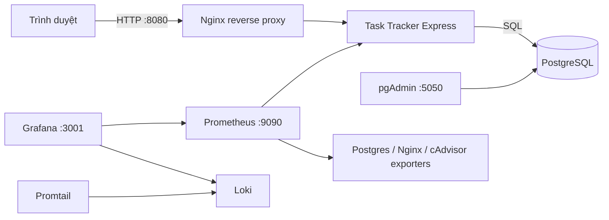

# DTC245200775 — Task Tracker (Đề 24)

> Ứng dụng quản lý công việc dùng Node.js/Express và PostgreSQL; toàn bộ dịch vụ được khai báo bằng Docker Compose. Repository chứa source, cấu hình Nginx, giám sát Prometheus/Grafana, log tập trung Loki/Promtail và báo cáo học phần.

## 1. Kiến trúc



Các mạng Compose giới hạn giao tiếp theo chức năng:

| Mạng | Service thành viên | Mục đích |
|---|---|---|
| `front` | `task-app`, `nginx`, `nginx-exporter` | Giao diện qua reverse proxy và Nginx status |
| `data` (`internal`) | `task-app`, `db`, `pgadmin`, `postgres-exporter` | Truy cập PostgreSQL và quản trị database |
| `observability` (`internal`) | `task-app`, `nginx`, exporters, Prometheus, Loki, Promtail, Grafana, cAdvisor | Metrics và log nội bộ |
| `management` | `pgadmin`, Prometheus, Grafana | Hỗ trợ publish các giao diện quản trị trên Docker Desktop |

`management` là bridge không internal nên các container thành viên có outbound connectivity; các cổng host của chúng vẫn bind `127.0.0.1`, không mở trực tiếp ra LAN. PostgreSQL lưu dữ liệu trong volume `postgres_data`.

## 2. Chuẩn bị và khởi động

- Docker Desktop đang chạy với Linux containers và Docker Compose v2.
- Git nếu cần clone repository; trình duyệt web.
- Các cổng cục bộ 8080, 5050, 9090 và 3001 còn trống.

```bash
git clone https://github.com/quocdoanhdang8/DTC245200775-task-tracker-de24.git
cd DTC245200775-task-tracker-de24
cp .env.example .env
```

Mở `.env` và thay từng giá trị `REPLACE_WITH_...` bằng mật khẩu dài, ngẫu nhiên và khác nhau. Không chia sẻ hoặc commit `.env`. PowerShell có thể tạo giá trị ngẫu nhiên bằng lệnh:

```powershell
[Convert]::ToBase64String((1..32 | ForEach-Object { Get-Random -Maximum 256 }))
```

Kiểm tra Compose và khởi động stack:

```bash
docker compose config
docker compose up -d --build
docker compose ps
docker compose logs --tail=100 task-app db nginx
```

Lần đầu có thể mất vài phút để tải image. `log-init` chuẩn bị quyền ghi cho thư mục log dùng chung. PostgreSQL tạo role database ở lần khởi tạo volume đầu tiên. Ứng dụng chạy migration `db/migrations/001_tasks.sql` trước khi mở cổng nội bộ.

## 3. URL và thao tác ứng dụng

| Thành phần | URL | Đăng nhập |
|---|---|---|
| Task Tracker qua Nginx | http://localhost:8080 | Không yêu cầu |
| Health check | http://localhost:8080/health | Không yêu cầu |
| pgAdmin | http://localhost:5050 | Email `PGADMIN_EMAIL`, mật khẩu `PGADMIN_PASSWORD` trong `.env` |
| Prometheus | http://localhost:9090 | Không yêu cầu; cổng chỉ bind loopback |
| Grafana | http://localhost:3001 | `GRAFANA_ADMIN_USER` và `GRAFANA_ADMIN_PASSWORD` trong `.env` |

pgAdmin được cấp cấu hình server “Task Tracker PostgreSQL” với host `db`, port `5432`, database `task_tracker` và role `task_app`. Ở lần kết nối đầu, nhập `TASK_DB_PASSWORD` làm password PostgreSQL. Nếu server không xuất hiện, tạo thủ công theo cùng thông số. Role ứng dụng không có quyền superuser.

Trang web cho phép tạo, xem, sửa, xóa, lọc công việc. Trạng thái hợp lệ: `todo`, `in_progress`, `done`. Mức ưu tiên hợp lệ: `low`, `medium`, `high`; ngày theo `YYYY-MM-DD`.

Ví dụ tạo và liệt kê công việc bằng HTTP:

```bash
curl.exe -X POST http://localhost:8080/api/tasks \
  -H 'Content-Type: application/json' \
  -d '{"title":"Chuẩn bị demo","description":"Kiểm tra ứng dụng và dashboard","dueDate":"2026-10-31","status":"in_progress","priority":"high"}'
curl.exe http://localhost:8080/api/tasks
curl.exe 'http://localhost:8080/api/tasks?status=in_progress'
```

## 4. Prometheus và Grafana

Trong Prometheus mở **Status → Targets**. Các job được cấu hình là `prometheus`, `task_tracker_app`, `postgres`, `nginx` và `containers`; trạng thái thực tế cần kiểm tra sau khi chạy. Ứng dụng cung cấp `/metrics` trên mạng container. Postgres Exporter thu thập thống kê PostgreSQL; Nginx Exporter đọc `stub_status`; cAdvisor cung cấp metrics container.

Grafana provision datasource Prometheus, datasource Loki và dashboard **Task Tracker Overview**. Dashboard có biểu đồ tốc độ request, độ trễ p95 của API, tình trạng Postgres Exporter, kết nối Nginx và CPU container. Xác minh các series sau khi chạy. Khả năng đọc metrics cAdvisor có thể khác nhau giữa Docker Engine Linux và Docker Desktop.

## 5. Loki, Promtail và LogQL

Mở **Grafana → Explore**, chọn nguồn **Loki** rồi chạy các truy vấn sau. Nhãn khớp với `monitoring/promtail/config.yml`:

```logql
{service="task-tracker"} | json
{service="task-tracker", level="50"} | json | line_format "{{.msg}}"
{service="nginx", log_type="access"} |= "/api/tasks"
```

Truy vấn đầu đọc log JSON của ứng dụng; truy vấn hai lọc log mức error do Pino ghi với `level=50`; truy vấn ba tìm request API trong access log Nginx. Tạo task hoặc gọi `/health` trước để phát sinh log. Kết quả thực tế cần kiểm tra trong Grafana.

**Lưu ý về công cụ theo yêu cầu môn:** Promtail được đưa vào để khớp đề thực hành, nhưng đã hết vòng đời hỗ trợ từ ngày 2/3/2026. Hãy dùng nó cho bài demo theo rubric; nếu tiếp tục duy trì hệ thống, lên kế hoạch chuyển sang Grafana Alloy sau khi xác nhận với giảng viên.

## 6. Hardening đã cấu hình

- Ứng dụng chạy bằng UID 10001, root filesystem chỉ đọc, bỏ Linux capabilities và chỉ có `/tmp` tạm thời.
- Nginx dùng image unprivileged, chỉ lắng nghe cổng 8080, root filesystem chỉ đọc; thêm CSP, `X-Content-Type-Options`, `X-Frame-Options`, `Referrer-Policy` và `Permissions-Policy`.
- Mạng `front`, `data` và `observability` phân tách giao tiếp; `data` và `observability` được khai báo internal. Cổng quản trị bind ở loopback.
- PostgreSQL có role riêng cho ứng dụng, không dùng superuser cho truy vấn nghiệp vụ. Truy vấn SQL dùng placeholders.
- `.env`, key và thư mục chứng chỉ bị loại khỏi Git; `.env.example` chỉ có giá trị cần thay.
- Cấu hình Prometheus, Loki, Promtail và pgAdmin mount ở chế độ chỉ đọc.
- cAdvisor cần đọc một số mount hệ thống của Docker host để xem chỉ số container; các mount khai báo là read-only, service không chạy `privileged`. Docker Desktop có thể cần kiểm tra thêm hoặc tắt cAdvisor nếu môi trường không cho phép.

Các cổng được bind cho demo trên máy cá nhân. Không mở pgAdmin, Grafana hay Prometheus trực tiếp ra Internet. Một hệ thống public cần TLS hợp lệ, xác thực và quy tắc mạng bổ sung.

## 7. Dừng, reset và xử lý lỗi

```bash
docker compose down                 # dừng, giữ dữ liệu
docker compose down -v              # xóa cả volume và dữ liệu
docker compose logs -f task-app
docker compose exec db psql -U postgres -d task_tracker -c '\dt'
```

`docker compose down -v` xóa PostgreSQL, pgAdmin, Grafana, Loki và Prometheus data; chỉ dùng khi muốn reset dữ liệu demo. Đổi mật khẩu trong `.env` không tự thay mật khẩu của role đã lưu trong PostgreSQL hiện hữu. Cập nhật role bằng SQL hoặc tạo lại volume khi dữ liệu có thể bỏ.

| Triệu chứng | Kiểm tra |
|---|---|
| Website không mở | `docker compose ps`, rồi `docker compose logs task-app nginx db`; đợi DB và app báo `healthy`. |
| PostgreSQL từ chối đăng nhập | Xác nhận `.env` dùng cùng `TASK_DB_PASSWORD` đã dùng khi tạo volume. |
| Cổng bị chiếm | Đổi cổng host ở vế trái của port mapping rồi dùng URL mới. |
| Loki chưa có log | Tạo request, xem `docker compose logs promtail loki`, kiểm tra volume `service_logs`. |
| Target `containers` down | Kiểm tra host mounts cAdvisor và engine Linux trong Docker Desktop. |
| Không có `docker compose` | Cập nhật Docker Desktop rồi chạy `docker compose version`. |

## 8. Kiểm tra và kết quả thực tế

- **Unit & API Tests:** Chạy `cd app && npm test` đạt **12/12 pass** (bao gồm input validation, routes, error handling).
- **Cú pháp JavaScript:** Kiểm tra cú pháp hợp lệ bằng `node --check app/src/server.js`, `node --check app/src/validation.js`, `node --check app/public/app.js`.
- **Trạng thái Docker:** Chạy `docker compose config` hợp lệ; khởi động thành công 12/12 container (`task-app`, `nginx`, `db`, `cadvisor` đều `healthy`; `prometheus`, `grafana`, `pgadmin`, `loki`, `promtail`, `nginx-exporter`, `postgres-exporter` đều `UP`).
- **HTTP & E2E Testing:** Xác minh qua reverse proxy Nginx (`http://localhost:8080`): các luồng CRUD task hoạt động chuẩn xác, response headers có đầy đủ 5 security headers (CSP, X-Frame-Options, X-Content-Type-Options, Referrer-Policy, Permissions-Policy). Không rò rỉ stack trace hay thông tin nhạy cảm.
- **Monitoring & Logs:** 5/5 targets trong Prometheus đều `UP` (100%); Grafana dashboard `Task Tracker Overview` hiển thị số liệu trực tiếp; Promtail chuyển tiếp log thành công và 3 truy vấn LogQL trong Loki đều trả về log thực tế.

## 9. Báo cáo và ảnh minh chứng

Báo cáo được biên soạn tại `docs/bao-cao-de24.docx` (sinh tự động từ `docs/bao-cao-de24.md` qua `python docs/build_report.py`). Không sử dụng ảnh chụp giả. Sinh viên tự chụp ảnh màn hình từ hệ thống đang chạy thật trên máy theo danh mục vị trí ảnh minh chứng:
- **Hình 4.1:** Giao diện Task Tracker có các công việc demo.
- **Hình 4.2:** pgAdmin kết nối và truy vấn bảng `tasks`.
- **Hình 5.1:** Website qua Nginx và tab Network hiển thị security headers.
- **Hình 6.1:** Prometheus Status → Targets (5/5 job UP).
- **Hình 6.2:** Grafana Dashboard Task Tracker Overview.
- **Hình 7.1:** Grafana Explore với kết quả 3 truy vấn LogQL.
- **Hình 8.1:** Kiểm tra user non-root của app và danh sách các network Docker.

Điền thông tin cá nhân còn thiếu: **[HỌ VÀ TÊN]**, **[MSSV]**, **[LỚP]**, **[TRƯỜNG/KHOA]**, **[GIẢNG VIÊN]**, **[NĂM HỌC]** trước khi nộp bài.

## 10. Ba mốc commit đề xuất

1. `feat: add task tracker app, postgres, pgadmin and nginx`
2. `feat: add prometheus grafana and application exporters`
3. `feat: add loki promtail hardening and course report`
