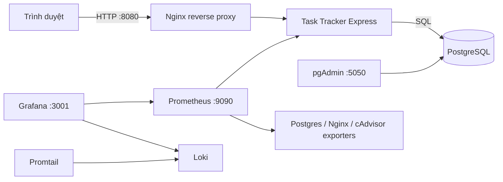

# DTC245200775 — Task Tracker (Đề 24)

> Ứng dụng quản lý công việc dùng Node.js/Express và PostgreSQL; toàn bộ dịch vụ được khai báo bằng Docker Compose. Repository chứa source, cấu hình Nginx, giám sát Prometheus/Grafana, log tập trung Loki/Promtail và báo cáo học phần.

## 1. Kiến trúc



Các mạng Compose giới hạn giao tiếp theo chức năng:

| Mạng | Service thành viên | Mục đích |
|---|---|---|
| `front` | `task-app`, `nginx`, `nginx-exporter` | Giao diện qua reverse proxy và Nginx status |
| `data` (`internal`) | `task-app`, `db`, `pgadmin`, `postgres-exporter` | Truy cập PostgreSQL và quản trị database |
| `observability` (`internal`) | `task-app`, `nginx`, exporters, Prometheus, Loki, Promtail, Grafana, cAdvisor | Metrics và log nội bộ |
| `management` | `pgadmin`, Prometheus, Grafana | Hỗ trợ publish các giao diện quản trị trên Docker Desktop |

`management` là bridge không internal nên các container thành viên có outbound connectivity; các cổng host của chúng vẫn bind `127.0.0.1`, không mở trực tiếp ra LAN. PostgreSQL lưu dữ liệu trong volume `postgres_data`.

## 2. Chuẩn bị và khởi động

Docker Desktop phải chạy Linux containers và Docker Compose v2. Các cổng 8080, 5050, 9090 và 3001 cần còn trống. Các lệnh dưới dành cho Windows PowerShell; chạy tại thư mục gốc repository.

```powershell
git clone https://github.com/quocdoanhdang8/DTC245200775-task-tracker-de24.git
Set-Location DTC245200775-task-tracker-de24
```

**Chỉ khi clone mới, chưa có `.env`:** dùng Node.js 22 trở lên để sinh năm mật khẩu riêng bằng `crypto.randomBytes`. Script không in mật khẩu và từ chối ghi đè `.env` đã có:

```powershell
node scripts/generate_env.js --email student@example.com
```

Thay email ví dụ bằng email muốn dùng để đăng nhập pgAdmin. Nếu không cài Node trên host, có thể dùng `Copy-Item .env.example .env` khi file đích chưa tồn tại rồi tự đặt năm mật khẩu dài, ngẫu nhiên và khác nhau. Không commit `.env`. Không chạy lại bước tạo môi trường trên máy đã có dữ liệu.

```powershell
docker compose config --quiet
docker compose up -d --build
docker compose ps -a
Invoke-RestMethod 'http://127.0.0.1:8080/health'
```

`config --quiet` kiểm tra cấu hình mà không in mật khẩu đã nội suy. Lần đầu tải image có thể mất vài phút. Có **12 service**: 11 service vận hành và `log-init` chạy một lần rồi `Exited (0)`. Các service có healthcheck gồm app, PostgreSQL, Nginx và cAdvisor; không gọi tất cả container là healthy.

PostgreSQL tạo role khi volume được khởi tạo lần đầu; app chạy migration trước khi mở cổng. Dữ liệu PostgreSQL nằm trong `postgres_data`. Đổi `.env` không tự đổi mật khẩu tài khoản đã tồn tại trong database, Grafana hoặc pgAdmin.

## 3. URL và thao tác ứng dụng

| Thành phần | URL | Đăng nhập |
|---|---|---|
| Task Tracker qua Nginx | http://127.0.0.1:8080 | Không yêu cầu |
| Health check | http://127.0.0.1:8080/health | Không yêu cầu |
| pgAdmin | http://127.0.0.1:5050 | `PGADMIN_EMAIL`, `PGADMIN_PASSWORD` trong `.env` |
| Prometheus | http://127.0.0.1:9090/targets | Không yêu cầu; bind loopback |
| Grafana | http://127.0.0.1:3001 | `GRAFANA_ADMIN_USER`, `GRAFANA_ADMIN_PASSWORD` |

pgAdmin có cấu hình **Task Tracker PostgreSQL**: host `db`, port `5432`, database `task_tracker`, username `task_app`. Nhập `TASK_DB_PASSWORD` khi kết nối; nếu chưa hiện server, đăng ký thủ công với cùng thông số. Không đưa mật khẩu vào ảnh minh chứng.

Ứng dụng phục vụ quản lý công việc cá nhân: tạo, xem, sửa, xóa và lọc trạng thái. Có deadline, mô tả, mức ưu tiên `low/medium/high` và trạng thái `todo/in_progress/done`. Chưa triển khai đăng nhập hoặc phân quyền nhóm. API hỗ trợ tìm kiếm bằng `q`.

Ví dụ PowerShell sau tạo task rồi tự dọn task đó; không gặp lỗi dấu nháy JSON như khi truyền JSON trực tiếp qua `curl.exe` trên Windows PowerShell cũ:

```powershell
$base = 'http://127.0.0.1:8080'
$body = @{ title = 'Cong viec demo'; dueDate = '2026-10-31'; status = 'in_progress'; priority = 'high' } | ConvertTo-Json
$task = Invoke-RestMethod "$base/api/tasks" -Method Post -ContentType 'application/json' -Body $body
try {
    Invoke-RestMethod "$base/api/tasks?status=in_progress"
} finally {
    Invoke-RestMethod "$base/api/tasks/$($task.id)" -Method Delete
}
```

Ngày dùng `YYYY-MM-DD` (năm 0001–9999); bỏ hạn hoặc gửi `null`/chuỗi rỗng được chuẩn hóa thành `null`. API giữ PostgreSQL DATE dưới dạng ngày lịch, không chuyển qua UTC làm lệch ngày theo múi giờ. ID task phải là số nguyên dương trong miền BIGINT. Dữ liệu sai trả 400, task không tồn tại trả 404, JSON quá 32 KB trả 413 tại app.

## 4. Prometheus và Grafana

Prometheus có năm job: `prometheus`, `task_tracker_app`, `postgres`, `nginx`, `containers`. Trong trang Targets, kiểm tra cả năm đều **UP** sau khi stack sẵn sàng. `UP` chứng minh scrape thành công; kiểm tra thêm `pg_up=1` và `nginx_up=1` để xác nhận exporter đọc được dịch vụ.

Grafana provision hai datasource **Prometheus**, **Loki** và dashboard **Task Tracker Overview** với năm panel: request rate, latency p95, PostgreSQL health, Nginx active connections, container CPU. Phát sinh request, chọn time range phù hợp rồi refresh. Metric `task_tracker_http_requests_total` là counter; tốc độ request dùng `rate(...[5m])`. cAdvisor có thể cung cấp số liệu khác nhau giữa Docker Desktop và Docker Engine Linux.

## 5. Loki Promtail và LogQL

Trong Grafana Explore chọn **Loki**, chọn khoảng thời gian có request rồi chạy từng query:

```logql
{service="task-tracker"} | json
```

```logql
{service="task-tracker"} | json | statusCode >= 200 and statusCode < 300
```

```logql
{service="nginx", log_type="access"} |= "/api/tasks"
```

Ba query lần lượt đọc JSON ứng dụng, lọc HTTP thành công 2xx và tìm access log API. Nhãn khớp `monitoring/promtail/config.yml`. Có thể lọc error Pino bằng `{service="task-tracker", level="50"} | json`; query này có thể rỗng nếu chưa phát sinh lỗi runtime. Lỗi DB giả lập trong unit tests không phải mặc nhiên là log runtime trong Loki.

Promtail được giữ theo yêu cầu đề bài. Khi phát triển tiếp ngoài phạm vi học phần, đánh giá công cụ thu thập log còn được hỗ trợ, chẳng hạn Grafana Alloy, cùng kiểm thử tương thích.

## 6. Hardening

- App chạy UID 10001; Nginx chạy UID 101. Cả hai có `read_only: true`, `cap_drop: [ALL]`, `no-new-privileges` và tmpfs `/tmp`; vẫn ghi được vào volume log đã cấp quyền.
- `log-init` chạy root một lần để `chown` thư mục log rồi exit 0. Không khẳng định toàn bộ service đều chạy non-root hoặc đều read-only.
- `data` và `observability` là internal; `front` và `management` là bridge thường. Container đa mạng vẫn có thể đi ra ngoài qua mạng non-internal. Compose có thể tạo thêm mạng default cho service khởi tạo.
- App và PostgreSQL không publish cổng 3000/5432 ra host. Các UI quản trị bind `127.0.0.1`.
- Role `task_app` không phải superuser nhưng có `USAGE, CREATE` trên schema public để migration lúc khởi động; không phải role chỉ CRUD. `metrics_exporter` dùng `pg_monitor`. SQL nghiệp vụ dùng truy vấn tham số hóa.
- Nginx có CSP, X-Frame-Options, X-Content-Type-Options, Referrer-Policy, Permissions-Policy. Bản demo dùng HTTP kèm headers theo lựa chọn của đề; chưa phải HTTPS.
- `.env` được Git ignore; `.dockerignore` loại secrets, Git và tài liệu khỏi build context app. Dockerfile cài dependency bằng `npm ci` từ lockfile.
- cAdvisor không chạy privileged nhưng đọc mount hệ thống host; chỉ dùng cấu hình này trong môi trường demo đã kiểm chứng. Đưa ra Internet cần TLS, xác thực và rà soát quyền/mạng riêng.

Kiểm tra headers và user:

```powershell
curl.exe --noproxy '*' --fail -sS -I http://127.0.0.1:8080/
docker compose exec -T task-app id
docker compose exec -T nginx id
```

## 7. Kiểm thử và harness

Cài Node.js 22+ trên host để chạy script; cài dependencies bằng lockfile:

```powershell
npm --prefix app ci --ignore-scripts
npm --prefix app test
node --test scripts/qa_harness.test.js
npm --prefix app audit --omit=dev
```

Bộ ứng dụng có **12 ca Unit/API** với database giả lập. Harness bổ sung **20 ca hồi quy**: DATE theo múi giờ, ngày không hợp lệ, ID tràn BIGINT, HTTP 400/413/415, log/metrics của request bị từ chối, giới hạn nhãn metrics, sinh `.env`, Loki có/rỗng dữ liệu và retry, parser `.env`, marker thay đổi, cleanup E2E và exit codes.

**Harness dùng HTTP fixtures có chủ đích; kết quả của nó không thay cho xác minh Docker/PostgreSQL/Grafana/Loki thật.** Các lệnh runtime dưới đây cần stack đang chạy trên máy:

```powershell
node scripts/verify_e2e.js
node scripts/check_loki.js
node scripts/test_persistence.js
```

E2E kiểm tra tám bước qua Nginx, tạo task riêng và dọn task. Loki yêu cầu cả ba query có log entries; tự phát sinh GET an toàn và retry có giới hạn. Kiểm tra nhánh rỗng bằng `node scripts/check_loki.js --test-empty`: **exit 1 là kết quả mong đợi**, không phải runtime đang hỏng.

Persistence tự restart `db` và `task-app`; marker còn dở không bị ghi đè. Nếu phiên trước bị ngắt, dùng `node scripts/persistence_step2.js` để xác minh/dọn marker trước khi tạo mới. Có thể chạy thủ công: `node scripts/persistence_step1.js`, `docker compose restart db task-app`, `node scripts/persistence_step2.js`. Script chỉ xác minh restart đã thực hiện, không thay thế kiểm thử backup/restore.

### Kiểm tra giao diện bằng Chromium (tùy chọn)

`scripts/browser_smoke.js` chạy frontend thật trong Chromium với Express và database fixture cách ly: tạo/sửa/xóa, deadline, lọc, checkbox, rollback khi PATCH lỗi, escape HTML và ba chiều rộng 1440/768/390 px. Không chạm task thật. Playwright chỉ là công cụ kiểm thử tùy chọn, không phải dependency của image app:

```powershell
$browserTools = Join-Path $env:TEMP 'de24-browser-tools'
npm install --prefix $browserTools --no-save playwright
$env:PLAYWRIGHT_MODULE = Join-Path $browserTools 'node_modules\playwright'
node "$env:PLAYWRIGHT_MODULE\cli.js" install chromium
node scripts/browser_smoke.js
Remove-Item Env:PLAYWRIGHT_MODULE
```

## 8. Dừng và xử lý lỗi

```powershell
docker compose down
docker compose logs --tail=50 task-app db nginx
```

`down` giữ named volumes. **Chỉ dùng `docker compose down -v` khi chủ động muốn xóa dữ liệu** của PostgreSQL, pgAdmin, Grafana, Loki và Prometheus. Không reset volume để sửa lỗi đăng nhập nếu cần giữ dữ liệu; cập nhật đúng tài khoản trong dịch vụ tương ứng.

| Triệu chứng | Kiểm tra |
|---|---|
| Website chưa mở | `docker compose ps -a`; đợi app, DB, Nginx healthy rồi xem logs |
| PostgreSQL từ chối đăng nhập | Mật khẩu `.env` phải khớp role đã lưu trong volume |
| Cổng bị chiếm | Kiểm tra app khác; điều chỉnh host port và URL tương ứng |
| Loki chưa có log | Gọi `/health`, `/api/tasks`; xem Promtail/Loki logs và time range |
| Target containers DOWN | Kiểm tra cAdvisor mounts và Linux engine của Docker Desktop |
| Tạo môi trường báo file đã tồn tại | Giữ `.env` hiện hữu; script không tự ghi đè |
| Marker persistence còn dở | Chạy bước 2 để xác minh/dọn; giữ marker để điều tra nếu dữ liệu không khớp |

## 9. Báo cáo và minh chứng

`docs/bao-cao-de24.docx` là bản báo cáo rút gọn đã điền thông tin sinh viên; bản được kiểm tra trong Word có **21 trang, 18 hình**. Nguồn là `docs/bao-cao-de24.md`, builder là `docs/build_report.py`. Số trang có thể đổi nếu thay font, ảnh hoặc nội dung.

| Hình | Minh chứng |
|---|---|
| 1.1–1.2 | Khởi chạy Compose và trạng thái service |
| 3.1 | Sơ đồ kiến trúc, không phải ảnh runtime |
| 4.1–4.3 | Website, tạo task, lọc trạng thái |
| 4.4–4.5 | E2E và pgAdmin bảng tasks |
| 5.1 | Security headers |
| 6.1–6.3 | Prometheus targets, truy vấn metric, Grafana dashboard |
| 7.1–7.2 | Grafana Explore và ba query LogQL qua API |
| 8.1–8.4 | Unit/API tests, hardening, mạng/role/ports, persistence |

Chín ảnh PowerShell đã được thay bằng ảnh người dùng chụp trực tiếp; tám ảnh trình duyệt và sơ đồ được giữ lại. `docs/logs/` chứa nhật ký các phiên xác minh đã lưu; ID và thời gian có thể khác giữa các phiên. Không đổi ảnh/log thành bằng chứng của một lần chạy khác.

Để dựng lại Word cần Python, `python-docx`, `Pillow`:

```powershell
python -m pip install python-docx Pillow
python docs/build_report.py
```

Sau khi dựng lại, kiểm tra số trang mục lục và vị trí hình trong Word. PDF xuất trên máy nằm tại `docs/rendered/bao-cao-de24.pdf`; thư mục này được Git ignore nên clone mới không có sẵn PDF. Có thể xuất PDF từ Word.

`scripts/capture-evidence.ps1` là công cụ tùy chọn để **chụp lại**, cần desktop Windows mở khóa và Word COM. Nó ghi đè chín ảnh terminal sau khi chụp thành công, không dựng ảnh giả. Nếu muốn giữ ảnh chụp tay hiện tại, không chạy công cụ chụp lại. Không cần dùng script này để khởi động ứng dụng.

## 10. Lịch sử triển khai trên GitHub

Ba mốc triển khai đã có thật trong lịch sử:

1. `8d265c0`: Task Tracker, PostgreSQL, pgAdmin và Nginx.
2. `4c5451a`: Prometheus, Grafana và exporters.
3. `fc35b1e`: Loki, Promtail, hardening và báo cáo.

Các commit sau bổ sung kiểm thử, báo cáo và ảnh minh chứng. Dùng `git log --oneline --reverse` để đối chiếu; dùng `git status -sb` để kiểm tra trạng thái đồng bộ local/remote.
