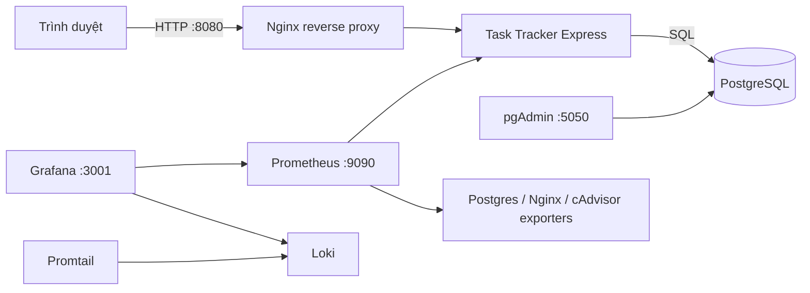

# DTC245200775 — Task Tracker (Đề 24)

> Ứng dụng quản lý công việc dùng Node.js/Express và PostgreSQL; toàn bộ dịch vụ được khai báo bằng Docker Compose. Repository chứa source, cấu hình Nginx, giám sát Prometheus/Grafana, log tập trung Loki/Promtail và báo cáo học phần.

## 1. Kiến trúc



Các mạng Compose giới hạn giao tiếp theo chức năng:

| Mạng | Service thành viên | Mục đích |
|---|---|---|
| `front` | `task-app`, `nginx`, `nginx-exporter` | Giao diện qua reverse proxy và Nginx status |
| `data` (`internal`) | `task-app`, `db`, `pgadmin`, `postgres-exporter` | Truy cập PostgreSQL và quản trị database |
| `observability` (`internal`) | `task-app`, `nginx`, exporters, Prometheus, Loki, Promtail, Grafana, cAdvisor | Metrics và log nội bộ |
| `management` | `pgadmin`, Prometheus, Grafana | Hỗ trợ publish các giao diện quản trị trên Docker Desktop |

`management` là bridge không internal nên các container thành viên có outbound connectivity; các cổng host của chúng vẫn bind `127.0.0.1`, không mở trực tiếp ra LAN. PostgreSQL lưu dữ liệu trong volume `postgres_data`.

## 2. Chuẩn bị và khởi động

Docker Desktop phải chạy Linux containers và Docker Compose v2. Các cổng 8080, 5050, 9090 và 3001 cần còn trống. Các lệnh dưới dành cho Windows PowerShell; chạy tại thư mục gốc repository.

```powershell
git clone https://github.com/quocdoanhdang8/DTC245200775-task-tracker-de24.git
Set-Location DTC245200775-task-tracker-de24
```

**Chỉ khi clone mới, chưa có `.env`:** dùng Node.js 22 trở lên để sinh năm mật khẩu riêng bằng `crypto.randomBytes`. Script không in mật khẩu và từ chối ghi đè `.env` đã có:

```powershell
node scripts/generate_env.js --email student@example.com
```

Thay email ví dụ bằng email muốn dùng để đăng nhập pgAdmin. Nếu không cài Node trên host, có thể dùng `Copy-Item .env.example .env` khi file đích chưa tồn tại rồi tự đặt năm mật khẩu dài, ngẫu nhiên và khác nhau. Không commit `.env`. Không chạy lại bước tạo môi trường trên máy đã có dữ liệu.

```powershell
docker compose config --quiet
docker compose up -d --build
docker compose ps -a
Invoke-RestMethod 'http://127.0.0.1:8080/health'
```

`config --quiet` kiểm tra cấu hình mà không in mật khẩu đã nội suy. Lần đầu tải image có thể mất vài phút. Có **12 service**: 11 service vận hành và `log-init` chạy một lần rồi `Exited (0)`. Các service có healthcheck gồm app, PostgreSQL, Nginx và cAdvisor; không gọi tất cả container là healthy.

PostgreSQL tạo role khi volume được khởi tạo lần đầu; app chạy migration trước khi mở cổng. Dữ liệu PostgreSQL nằm trong `postgres_data`. Đổi `.env` không tự đổi mật khẩu tài khoản đã tồn tại trong database, Grafana hoặc pgAdmin.

## 3. URL và thao tác ứng dụng

| Thành phần | URL | Đăng nhập |
|---|---|---|
| Task Tracker qua Nginx | http://127.0.0.1:8080 | Không yêu cầu |
| Health check | http://127.0.0.1:8080/health | Không yêu cầu |
| pgAdmin | http://127.0.0.1:5050 | `PGADMIN_EMAIL`, `PGADMIN_PASSWORD` trong `.env` |
| Prometheus | http://127.0.0.1:9090/targets | Không yêu cầu; bind loopback |
| Grafana | http://127.0.0.1:3001 | `GRAFANA_ADMIN_USER`, `GRAFANA_ADMIN_PASSWORD` |

pgAdmin có cấu hình **Task Tracker PostgreSQL**: host `db`, port `5432`, database `task_tracker`, username `task_app`. Nhập `TASK_DB_PASSWORD` khi kết nối; nếu chưa hiện server, đăng ký thủ công với cùng thông số. Không đưa mật khẩu vào ảnh minh chứng.

Ứng dụng phục vụ quản lý công việc cá nhân: tạo, xem, sửa, xóa và lọc trạng thái. Có deadline, mô tả, mức ưu tiên `low/medium/high` và trạng thái `todo/in_progress/done`. Chưa triển khai đăng nhập hoặc phân quyền nhóm. API hỗ trợ tìm kiếm bằng `q`.

Ví dụ PowerShell sau tạo task rồi tự dọn task đó; không gặp lỗi dấu nháy JSON như khi truyền JSON trực tiếp qua `curl.exe` trên Windows PowerShell cũ:

```powershell
$base = 'http://127.0.0.1:8080'
$body = @{ title = 'Cong viec demo'; dueDate = '2026-10-31'; status = 'in_progress'; priority = 'high' } | ConvertTo-Json
$task = Invoke-RestMethod "$base/api/tasks" -Method Post -ContentType 'application/json' -Body $body
try {
    Invoke-RestMethod "$base/api/tasks?status=in_progress"
} finally {
    Invoke-RestMethod "$base/api/tasks/$($task.id)" -Method Delete
}
```

Ngày dùng `YYYY-MM-DD` (năm 0001–9999); bỏ hạn hoặc gửi `null`/chuỗi rỗng được chuẩn hóa thành `null`. API giữ PostgreSQL DATE dưới dạng ngày lịch, không chuyển qua UTC làm lệch ngày theo múi giờ. ID task phải là số nguyên dương trong miền BIGINT. Dữ liệu sai trả 400, task không tồn tại trả 404, JSON quá 32 KB trả 413 tại app.

## 4. Prometheus và Grafana

Prometheus có năm job: `prometheus`, `task_tracker_app`, `postgres`, `nginx`, `containers`. Trong trang Targets, kiểm tra cả năm đều **UP** sau khi stack sẵn sàng. `UP` chứng minh scrape thành công; kiểm tra thêm `pg_up=1` và `nginx_up=1` để xác nhận exporter đọc được dịch vụ.

Grafana provision hai datasource **Prometheus**, **Loki** và dashboard **Task Tracker Overview** với năm panel: request rate, latency p95, PostgreSQL health, Nginx active connections, container CPU. Phát sinh request, chọn time range phù hợp rồi refresh. Metric `task_tracker_http_requests_total` là counter; tốc độ request dùng `rate(...[5m])`. cAdvisor có thể cung cấp số liệu khác nhau giữa Docker Desktop và Docker Engine Linux.

## 5. Loki Promtail và LogQL

Trong Grafana Explore chọn **Loki**, chọn khoảng thời gian có request rồi chạy từng query:

```logql
{service="task-tracker"} | json
```

```logql
{service="task-tracker"} | json | statusCode >= 200 and statusCode < 300
```

```logql
{service="nginx", log_type="access"} |= "/api/tasks"
```

Ba query lần lượt đọc JSON ứng dụng, lọc HTTP thành công 2xx và tìm access log API. Nhãn khớp `monitoring/promtail/config.yml`. Có thể lọc error Pino bằng `{service="task-tracker", level="50"} | json`; query này có thể rỗng nếu chưa phát sinh lỗi runtime. Lỗi DB giả lập trong unit tests không phải mặc nhiên là log runtime trong Loki.

Promtail được giữ theo yêu cầu đề bài. Khi phát triển tiếp ngoài phạm vi học phần, đánh giá công cụ thu thập log còn được hỗ trợ, chẳng hạn Grafana Alloy, cùng kiểm thử tương thích.

## 6. Hardening

- App chạy UID 10001; Nginx chạy UID 101. Cả hai có `read_only: true`, `cap_drop: [ALL]`, `no-new-privileges` và tmpfs `/tmp`; vẫn ghi được vào volume log đã cấp quyền.
- `log-init` chạy root một lần để `chown` thư mục log rồi exit 0. Không khẳng định toàn bộ service đều chạy non-root hoặc đều read-only.
- `data` và `observability` là internal; `front` và `management` là bridge thường. Container đa mạng vẫn có thể đi ra ngoài qua mạng non-internal. Compose có thể tạo thêm mạng default cho service khởi tạo.
- App và PostgreSQL không publish cổng 3000/5432 ra host. Các UI quản trị bind `127.0.0.1`.
- Role `task_app` không phải superuser nhưng có `USAGE, CREATE` trên schema public để migration lúc khởi động; không phải role chỉ CRUD. `metrics_exporter` dùng `pg_monitor`. SQL nghiệp vụ dùng truy vấn tham số hóa.
- Nginx có CSP, X-Frame-Options, X-Content-Type-Options, Referrer-Policy, Permissions-Policy. Bản demo dùng HTTP kèm headers theo lựa chọn của đề; chưa phải HTTPS.
- `.env` được Git ignore; `.dockerignore` loại secrets, Git và tài liệu khỏi build context app. Dockerfile cài dependency bằng `npm ci` từ lockfile.
- cAdvisor không chạy privileged nhưng đọc mount hệ thống host; chỉ dùng cấu hình này trong môi trường demo đã kiểm chứng. Đưa ra Internet cần TLS, xác thực và rà soát quyền/mạng riêng.

Kiểm tra headers và user:

```powershell
curl.exe --noproxy '*' --fail -sS -I http://127.0.0.1:8080/
docker compose exec -T task-app id
docker compose exec -T nginx id
```

## 7. Kiểm tra và demo theo yêu cầu Đề 24

Sau khi khởi động bằng Docker Compose, demo lần lượt các thành phần sau:

| Yêu cầu | Thao tác và kết quả cần kiểm tra |
|---|---|
| Ứng dụng quản lý công việc | Mở website qua Nginx tại cổng 8080; tạo task có deadline, sửa thông tin, đổi trạng thái, lọc và xóa task |
| PostgreSQL và pgAdmin | Mở pgAdmin tại cổng 5050, kết nối server `db`, xem bảng `public.tasks` và đối chiếu dữ liệu với website |
| Nginx reverse proxy | Truy cập ứng dụng qua cổng 8080; chạy lệnh kiểm tra năm security headers ở mục 6 |
| Prometheus và Grafana | Xác minh năm targets UP, `pg_up=1`, `nginx_up=1`; mở dashboard có dữ liệu container, web và database |
| Loki và Promtail | Trong Grafana Explore, thực hiện ba truy vấn LogQL ở mục 5 và xem log request vừa phát sinh |
| Hardening | Đối chiếu user non-root, filesystem read-only, capabilities, mạng internal, cổng loopback và quyền DB theo mục 6 |
| GitHub và báo cáo | Đối chiếu ba commit triển khai ở mục 10; mở báo cáo có bìa sinh viên, kiến trúc và ảnh minh chứng ở mục 9 |

#### Kết quả Windows do người dùng cung cấp

Người dùng báo đã build và chạy stack trên Windows: 11 service vận hành, `log-init` kết thúc `Exited (0)`; E2E 8/8 với task ID 28 đã dọn; ba query Loki có dữ liệu; persistence giữ nguyên marker ID 29 qua restart rồi dọn. Năm Prometheus jobs (`containers`, `nginx`, `postgres`, `prometheus`, `task_tracker_app`) đều UP, `pg_up=1`, `nginx_up=1`; dashboard Grafana có dữ liệu ở cả năm panel. Đây là kết quả người dùng cung cấp, không phải lần chạy của phiên Codex này; log/ảnh hiện có trong repository vẫn là minh chứng của các phiên trước.

### Kiểm thử tự động bổ sung (tùy chọn)

Các công cụ sau hỗ trợ kiểm tra lại kết quả; không bắt buộc để khởi chạy hệ thống hoặc demo. Cần Node.js 22+ trên host. Tất cả dịch vụ của hệ thống vẫn chạy bằng Docker Compose.

```powershell
npm --prefix app ci --ignore-scripts
npm --prefix app test
node scripts/verify_e2e.js
node scripts/check_loki.js
node scripts/test_persistence.js
```

Unit/API có 13 ca dùng database giả lập. E2E kiểm tra tám bước qua Nginx và dọn task thử; Loki yêu cầu ba truy vấn có log thật. Persistence **tự restart `db` và `task-app`** để kiểm tra task còn nguyên vẹn rồi dọn task; nếu marker phiên trước còn dở, chạy `node scripts/persistence_step2.js` để xác minh/dọn trước khi thử lại.

Chi tiết harness hồi quy, Chromium và cách xử lý các tình huống kiểm thử nằm trong [tài liệu kiểm thử bổ sung](docs/qa-review.md#hướng-dẫn-kiểm-thử-bổ-sung-tùy-chọn). Kết quả dùng database/HTTP giả lập không thay thế demo và kiểm chứng các dịch vụ thật nêu trên.

## 8. Dừng và xử lý lỗi

```powershell
docker compose down
docker compose logs --tail=50 task-app db nginx
```

`down` giữ named volumes. **Chỉ dùng `docker compose down -v` khi chủ động muốn xóa dữ liệu** của PostgreSQL, pgAdmin, Grafana, Loki và Prometheus. Không reset volume để sửa lỗi đăng nhập nếu cần giữ dữ liệu; cập nhật đúng tài khoản trong dịch vụ tương ứng.

| Triệu chứng | Kiểm tra |
|---|---|
| Website chưa mở | `docker compose ps -a`; đợi app, DB, Nginx healthy rồi xem logs |
| PostgreSQL từ chối đăng nhập | Mật khẩu `.env` phải khớp role đã lưu trong volume |
| Cổng bị chiếm | Kiểm tra app khác; điều chỉnh host port và URL tương ứng |
| Loki chưa có log | Gọi `/health`, `/api/tasks`; xem Promtail/Loki logs và time range |
| Target containers DOWN | Kiểm tra cAdvisor mounts và Linux engine của Docker Desktop |
| Tạo môi trường báo file đã tồn tại | Giữ `.env` hiện hữu; script không tự ghi đè |
| Marker persistence còn dở | Chạy bước 2 để xác minh/dọn; giữ marker để điều tra nếu dữ liệu không khớp |

## 9. Báo cáo và minh chứng

Báo cáo đang được rà soát tại [Word](docs/bao-cao-de24.docx) và [PDF](docs/bao-cao-de24.pdf). PDF có đúng 10 trang và đã được xem từng trang; gồm 18 hình nội dung và logo ICTU trên bìa. Hai đoạn trang 10 được cập nhật bằng Times New Roman để phân biệt ảnh 12 ca cũ, code 13/13 và kết quả runtime Windows do người dùng cung cấp. Word COM không khởi tạo được trong môi trường này, nên chưa xác nhận phân trang Word hoặc đồng bộ cuối giữa hai tệp. Chưa bàn giao/commit bộ này cho tới khi xác nhận được phân trang Word.

| Hình | Minh chứng |
|---|---|
| 1 | Sơ đồ kiến trúc |
| 2–3 | Khởi chạy Compose và trạng thái service |
| 4–6 | Website, task, pgAdmin, E2E và security headers |
| 7 | Prometheus targets, metric và Grafana dashboard |
| 8 | Grafana Explore và ba query LogQL |
| 9 | Hardening, mạng, role và cổng |
| 10 | Unit/API tests và persistence |

Chín ảnh PowerShell đã được thay bằng ảnh người dùng chụp trực tiếp; tám ảnh trình duyệt và sơ đồ được giữ lại. `docs/logs/` chứa nhật ký các phiên xác minh đã lưu; ID và thời gian có thể khác giữa các phiên. Không đổi ảnh/log thành bằng chứng của một lần chạy khác.

Để dựng lại Word cần Python, `python-docx`, `Pillow`:

```powershell
python -m pip install python-docx Pillow
python docs/build_report.py
```

Builder tạo `docs/bao-cao-de24.docx` từ Markdown `docs/bao-cao-de24.md`; logo dùng `docs/ictu-logo.jpg`, 18 hình nội dung lấy từ assets đã theo dõi. Nguồn giữ 9 ngắt trang chủ động và Times New Roman. Hình 17 là ảnh kiểm thử 12 ca phiên cũ; phần chữ ghi riêng kết quả 13/13 và QA harness 20/20 từ phiên kiểm tra code trước. Kết quả Windows mới do người dùng cung cấp được ghi riêng, không quy cho phiên Codex hiện tại.

`scripts/capture-evidence.ps1` là công cụ tùy chọn để **chụp lại**, cần desktop Windows mở khóa và Word COM. Nó ghi đè chín ảnh terminal sau khi chụp thành công, không dựng ảnh giả. Nếu muốn giữ ảnh chụp tay hiện tại, không chạy công cụ chụp lại. Không cần dùng script này để khởi động ứng dụng.

## 10. Lịch sử triển khai trên GitHub

Ba mốc triển khai đã có thật trong lịch sử:

1. `8d265c0`: Task Tracker, PostgreSQL, pgAdmin và Nginx.
2. `4c5451a`: Prometheus, Grafana và exporters.
3. `fc35b1e`: Loki, Promtail, hardening và báo cáo.

Các commit sau bổ sung kiểm thử, báo cáo và ảnh minh chứng. Dùng `git log --oneline --reverse` để đối chiếu; dùng `git status -sb` để kiểm tra trạng thái đồng bộ local/remote.
