# BÁO CÁO THỰC HÀNH

## TRIỂN KHAI VÀ QUẢN TRỊ HỆ THỐNG PHẦN MỀM

### ĐỀ TÀI 24 — HỆ THỐNG QUẢN LÝ CÔNG VIỆC TASK TRACKER

**Sinh viên:** Đặng Quốc Doanh

**Mã số sinh viên:** DTC245200775

**Lớp:** KHMT K23A

**Trường/Khoa:** Trường Đại Học Công Nghệ Thông Tin Và Truyền Thông Thái Nguyên

**Giảng viên hướng dẫn:** Hoàng Văn Tâm

**Năm học:** 2026

**Thái Nguyên, tháng 10 năm 2026**

<!-- PAGEBREAK -->

# LỜI CẢM ƠN VÀ TÓM TẮT

Em xin trân trọng gửi lời cảm ơn sâu sắc tới Giảng viên hướng dẫn học phần Triển khai và Quản trị Hệ thống Phần mềm đã trang bị cho sinh viên nền tảng lý thuyết vững chắc và định hướng thực hành toàn diện. Khóa học đã giúp sinh viên nắm vững phương pháp đóng gói phần mềm bằng container, quy hoạch mạng nội bộ, quản trị cơ sở dữ liệu quan hệ, thiết lập reverse proxy bảo vệ tầng biên, giám sát số liệu hiệu năng theo thời gian thực (metrics), tập trung hóa nhật ký vận hành (logging) và áp dụng các nguyên tắc tăng cường an ninh (hardening) theo tiêu chuẩn công nghiệp hiện đại.

Báo cáo này trình bày toàn bộ quá trình phân tích thiết kế, cài đặt triển khai, kiểm thử thực nghiệm và vận hành hệ thống Quản lý Công việc — Task Tracker (Đề tài 24). Toàn bộ hệ thống được đóng gói và điều phối thống nhất thông qua Docker Compose với 12 dịch vụ thành phần:
- Ứng dụng nghiệp vụ: Node.js/Express (Task Tracker API & Web UI) kết nối cơ sở dữ liệu quan hệ PostgreSQL 17 và công cụ quản trị web pgAdmin 4.
- Cổng tiếp nhận và bảo vệ biên: Nginx Reverse Proxy được cấu hình unprivileged, áp dụng 5 HTTP Security Headers tiêu chuẩn và che giấu cổng ứng dụng nội bộ.
- Hệ thống giám sát metrics: Prometheus v3 scrape định kỳ 15 giây từ 5 mục tiêu (Node.js runtime metrics qua prom-client, PostgreSQL Exporter, Nginx Exporter, cAdvisor cho container resource, và Prometheus tự giám sát); Grafana v13 trực quan hóa bảng điều khiển thời gian thực.
- Hệ thống tập trung nhật ký log: Nhật ký JSON có cấu trúc từ ứng dụng và access/error log từ Nginx được Promtail thu thập qua volume chia sẻ chỉ đọc và đẩy về Loki v3, cho phép truy vấn chuyên sâu bằng ngôn ngữ LogQL qua Grafana Explore.
- Tăng cường bảo mật (Hardening): Thực thi nguyên tắc đặc quyền tối thiểu (Least Privilege), container ứng dụng và Nginx chạy bằng tài khoản non-root (UID 10001, 101), phong tỏa hệ thống tệp gốc ở chế độ chỉ đọc (`read_only: true`), thu hồi toàn bộ Linux Capabilities (`cap_drop: [ALL]`), kích hoạt `no-new-privileges` rộng rãi, phân tách 4 mạng Docker chuyên trách (trong đó 2 mạng `data` và `observability` được bảo vệ với cờ `internal: true`, 2 mạng `front` và `management` là bridge tiêu chuẩn), và cô lập các cổng dịch vụ quản trị/dữ liệu vào địa chỉ loopback `127.0.0.1`.

Hệ thống tài liệu bao gồm chính xác 18 hình: 1 sơ đồ kiến trúc hệ thống và luồng dữ liệu (Hình 3.1) được kết xuất trực quan từ thiết kế kỹ thuật, cùng 17 ảnh minh chứng thực nghiệm trích xuất trực tiếp từ giao diện đồ họa (UI) và kết quả thực thi các câu lệnh an toàn trên terminal hệ thống, đi kèm dữ liệu đầu ra thô (raw terminal output) đã che mờ thông tin bảo mật để đối chiếu và tái hiện.

**Từ khóa:** Docker Compose, Task Tracker, Node.js, Express, PostgreSQL, pgAdmin, Nginx Reverse Proxy, Security Headers, Prometheus, Grafana, Loki, Promtail, LogQL, Container Hardening, Least Privilege.

<!-- PAGEBREAK -->

# MỤC LỤC

| Nội dung | Trang |
|---|---:|
| Lời cảm ơn và tóm tắt | 2 |
| Mục lục, Danh mục hình và Danh mục bảng | 3–4 |
| Chương 1 — Giới thiệu đề tài, mục tiêu và yêu cầu | 5–8 |
| Chương 2 — Cơ sở lý thuyết nền tảng | 9–10 |
| Chương 3 — Phân tích và thiết kế kiến trúc hệ thống | 11–13 |
| Chương 4 — Xây dựng ứng dụng Task Tracker và tích hợp PostgreSQL | 14–19 |
| Chương 5 — Nginx Reverse Proxy và Bảo vệ HTTP | 20–22 |
| Chương 6 — Giám sát hệ thống bằng Prometheus và Grafana | 23–26 |
| Chương 7 — Thu thập và tập trung Log với Loki, Promtail và LogQL | 27–30 |
| Chương 8 — Hardening, kiểm thử toàn diện và đánh giá an toàn | 31–40 |
| Kết luận và hướng phát triển | 41 |
| Tài liệu tham khảo | 42 |
| Phụ lục A — Hướng dẫn cài đặt và vận hành trên Windows | 43–44 |
| Phụ lục B — Checklist nghiệm thu và kịch bản demo | 45 |

<!-- PAGEBREAK -->

## DANH MỤC HÌNH

- Hình 1.1. Kiểm tra cấu hình Compose và khởi động stack bằng `docker compose up -d --build`.
- Hình 1.2. Trạng thái hoạt động của 12 containers sau khi khởi chạy bằng `docker compose ps`.
- Hình 3.1. Sơ đồ kiến trúc các thành phần và luồng dữ liệu (HTTP Request, Metrics, Centralized Log).
- Hình 4.1. Giao diện Task Tracker tại `http://127.0.0.1:8080` với danh sách công việc mẫu đa dạng trạng thái và mức ưu tiên.
- Hình 4.2. Thao tác nhập liệu và tạo công việc mới trên biểu mẫu giao diện người dùng.
- Hình 4.3. Tính năng lọc danh sách công việc theo trạng thái ("Đang thực hiện") trên giao diện web.
- Hình 4.4. Thực thi kiểm thử tự động End-to-End (E2E) các API CRUD qua Nginx trên terminal.
- Hình 4.5. Giao diện pgAdmin 4 kết nối cơ sở dữ liệu `task_tracker` và hiển thị bảng `public.tasks`.
- Hình 5.1. Kiểm tra response headers bảo mật của website qua Nginx bằng `curl.exe -i`.
- Hình 6.1. Trạng thái 5/5 Prometheus Targets đạt UP 100% tại `http://127.0.0.1:9090/targets`.
- Hình 6.2. Đồ thị truy vấn metric ứng dụng `task_tracker_http_requests_total` trên Prometheus Graph.
- Hình 6.3. Dashboard giám sát trực quan hóa "Task Tracker Overview" trên Grafana theo thời gian thực.
- Hình 7.1. Giao diện Grafana Explore truy vấn tập trung log ứng dụng và Nginx qua datasource Loki.
- Hình 7.2. Thực thi và kiểm chứng 3 truy vấn LogQL thực tế trên terminal/API.
- Hình 8.1. Kết quả thực thi bộ kiểm thử ứng dụng tự động (`npm test`, 12/12 test pass).
- Hình 8.2. Xác minh thực nghiệm đặc quyền non-root (UID 10001, 101), ReadOnlyRootfs và drop capabilities.
- Hình 8.3. Kiểm tra phân tách mạng Docker (`Internal=true`), DB least privilege và cách ly port bindings.
- Hình 8.4. Kiểm tra tính bền vững dữ liệu (Persistence) qua marker task và lịch sử commit Git.

## DANH MỤC BẢNG

- Bảng 1.1. Ma trận đối chiếu tiêu chí đề bài, file cấu hình, phương pháp kiểm tra và hình ảnh minh chứng.
- Bảng 3.1. Vai trò, image, cổng nội bộ và cổng publish của các dịch vụ trong hệ thống.
- Bảng 4.1. Lược đồ cơ sở dữ liệu `tasks` trong PostgreSQL.
- Bảng 5.1. Chi tiết 5 HTTP Security Headers thiết lập trên Nginx Reverse Proxy.
- Bảng 6.1. Danh sách các scrape jobs và exporters trong Prometheus.
- Bảng 7.1. Ba mẫu truy vấn LogQL, mục đích phân tích và kết quả thực nghiệm.
- Bảng 8.1. Ma trận kiểm thử hệ thống và trạng thái nghiệm thu thực tế.

<!-- PAGEBREAK -->

# CHƯƠNG 1. GIỚI THIỆU ĐỀ TÀI, MỤC TIÊU VÀ YÊU CẦU

## 1.1 Bối cảnh đề tài

Trong hoạt động quản lý nhóm học tập hoặc dự án phần mềm quy mô vừa và nhỏ, việc theo dõi trạng thái công việc đóng vai trò then chốt đối với năng suất và tiến độ hoàn thành. Tuy nhiên, thông tin công việc thường bị phân mảnh trên nhiều kênh trao đổi (tin nhắn, bảng tính rời rạc hoặc ghi chú cá nhân), dẫn đến tình trạng chậm tiến độ, thiếu minh bạch về thứ tự ưu tiên và khó khăn trong việc phối hợp xử lý.

Đề tài 24 — Hệ thống Quản lý Công việc Task Tracker được thiết kế nhằm giải quyết bài toán trên thông qua một ứng dụng web gọn nhẹ, trực quan nhưng được xây dựng và vận hành trên một nền tảng hạ tầng hoàn chỉnh. Bài thực hành không chỉ dừng lại ở việc lập trình giao diện người dùng mà tập trung chuyên sâu vào quy trình đóng gói phần mềm chuẩn hóa, cô lập môi trường thực thi, thiết lập hệ thống cơ sở dữ liệu tin cậy, bảo vệ an toàn biên mạng, giám sát thông số vận hành và quản trị nhật ký tập trung.

## 1.2 Mục tiêu đề tài

1. **Xây dựng ứng dụng hoàn chỉnh:** Cung cấp đầy đủ các thao tác nghiệp vụ cốt lõi (CRUD: Thêm, Xem danh sách, Lọc, Sửa trạng thái, Xóa công việc) kèm xác thực dữ liệu chặt chẽ ở cả tầng ứng dụng và cơ sở dữ liệu.
2. **Lưu trữ dữ liệu bền vững:** Tích hợp PostgreSQL 17 thông qua Docker Volume độc lập, đảm bảo dữ liệu không bị thất thoát khi container khởi động lại hoặc cập nhật phiên bản; cấu hình pgAdmin 4 phục vụ quản trị trực quan.
3. **Bảo vệ cổng vào bằng Reverse Proxy:** Triển khai Nginx unprivileged tiếp nhận mọi truy cập từ bên ngoài, đóng vai trò Reverse Proxy chuyển tiếp yêu cầu đến máy chủ ứng dụng nội bộ, che giấu cổng thực của Node.js và áp dụng 5 HTTP Security Headers tiêu chuẩn.
4. **Giám sát số liệu hiệu năng:** Tích hợp Prometheus tự động thu thập metrics định kỳ từ ứng dụng, cơ sở dữ liệu, máy chủ proxy và tài nguyên phần cứng container; thiết lập bảng điều khiển Grafana Dashboard trực quan hóa theo thời gian thực.
5. **Tập trung hóa nhật ký vận hành:** Ứng dụng xuất log định dạng JSON có cấu trúc; Nginx ghi nhận access log và error log; Promtail thu thập nhật ký từ volume dùng chung và đẩy về Loki; hỗ trợ truy vấn, sàng lọc bằng ngôn ngữ LogQL qua Grafana Explore.
6. **Thực thi chính sách an toàn thông tin (Hardening):** Áp dụng nguyên tắc đặc quyền tối thiểu (Least Privilege), chạy ứng dụng và Nginx dưới quyền non-root (UID 10001, 101), phong tỏa quyền ghi hệ thống tệp gốc (`read_only: true`), thu hồi Linux Capabilities (`cap_drop: [ALL]`), kích hoạt `no-new-privileges` rộng rãi, phân tách các phân vùng mạng nội bộ chuyên trách (`data`, `observability` với `internal: true`) và cô lập cổng kết nối vào địa chỉ loopback `127.0.0.1`.

## 1.3 Phạm vi và tiêu chí hoàn thành

Phạm vi của dự án là một hệ thống hoàn chỉnh phục vụ kiểm thử và nghiệm thu thực tế trên máy tính cá nhân sử dụng Docker Desktop trên nền tảng Windows. Toàn bộ cấu hình được điều phối tự động thông qua Docker Compose, sẵn sàng tái hiện môi trường trong một câu lệnh duy nhất.

Để người đọc và hội đồng chấm thi dễ dàng theo dõi, Bảng 1.1 tổng hợp sự đối chiếu chi tiết giữa từng tiêu chí đánh giá của học phần với các thành phần hiện hữu trong repository và bằng chứng thực nghiệm đi kèm.

| TT | Tiêu chí đề bài | Tệp tin / Cấu hình phụ trách | Phương pháp kiểm tra thực nghiệm | Hình minh chứng |
|---|---|---|---|---|
| 1 | Khởi tạo và điều phối Compose | `docker-compose.yml`, `.env.example` | `docker compose config --quiet`, `docker compose up -d --build` | Hình 1.1, Hình 1.2 |
| 2 | Ứng dụng CRUD & Validation | `app/src/server.js`, `app/src/validation.js` | Giao diện web và script kiểm thử E2E tự động qua API Nginx | Hình 4.1, 4.2, 4.3, 4.4 |
| 3 | Cơ sở dữ liệu PostgreSQL & pgAdmin | `db/migrations/001_tasks.sql`, `docker-compose.yml` | Truy vấn `public.tasks` trên pgAdmin và kiểm tra role trong terminal | Hình 4.5, Hình 8.3 |
| 4 | Nginx Proxy & Security Headers | `nginx/default.conf`, `nginx/Dockerfile` | Lệnh `curl.exe -i http://127.0.0.1:8080/` kiểm tra 5 headers | Hình 5.1 |
| 5 | Giám sát Prometheus & Exporters | `monitoring/prometheus/prometheus.yml` | Truy cập `http://127.0.0.1:9090/targets` kiểm tra 5/5 targets UP | Hình 6.1, Hình 6.2 |
| 6 | Trực quan hóa Grafana Dashboard | `monitoring/grafana/dashboards/` | Mở `http://127.0.0.1:3001` xem biểu đồ rate, latency, cpu, status | Hình 6.3 |
| 7 | Logging Loki, Promtail & LogQL | `monitoring/promtail/`, `monitoring/loki/` | Thực thi 3 truy vấn LogQL trong Grafana Explore và qua API | Hình 7.1, Hình 7.2 |
| 8 | An ninh Hardening & Mạng nội bộ | `docker-compose.yml`, `app/Dockerfile` | `docker inspect` kiểm tra ReadOnlyRootfs, CapDrop, non-root UID | Hình 8.2, Hình 8.3 |
| 9 | Kiểm thử tự động & Bền vững | `app/test/`, volume `postgres_data` | Chạy `npm test` (12 pass) và kịch bản restart marker task | Hình 8.1, Hình 8.4 |

*Bảng 1.1. Ma trận đối chiếu tiêu chí đề bài, file cấu hình, phương pháp kiểm tra và hình ảnh minh chứng*

## 1.4 Khởi động hệ thống và kiểm tra cú pháp Compose

1. **Mục tiêu:** Xác minh tính hợp lệ tuyệt đối của tệp cấu hình `docker-compose.yml` sau khi nội suy các biến môi trường từ `.env`, sau đó khởi động đồng bộ toàn bộ 12 dịch vụ của hệ thống.
2. **Lệnh thực hiện:**
```powershell
docker compose config --quiet
docker compose up -d --build
```
3. **Ảnh minh chứng:**

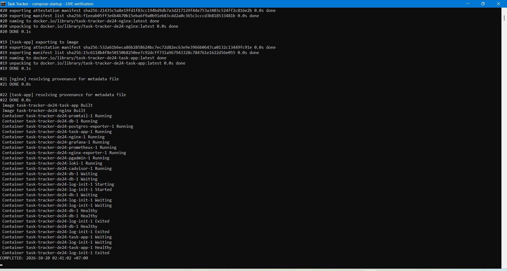
*Hình 1.1. Kiểm tra cấu hình Compose và khởi động stack bằng docker compose up -d --build*

4. **Kết quả quan sát và ý nghĩa:**
Lệnh `docker compose config --quiet` thoát với mã `0`, xác nhận không tồn tại lỗi cú pháp YAML và các biến môi trường bắt buộc (như mật khẩu cơ sở dữ liệu, tài khoản pgAdmin, tài khoản quản trị Grafana) đã được nạp đầy đủ từ tệp `.env`. Quá trình build và khởi chạy hoàn tất thành công cho toàn bộ 12 dịch vụ, các container lần lượt chuyển sang trạng thái sẵn sàng phục vụ.
5. **Cách tái hiện:**
Tại thư mục gốc dự án, sao chép `.env.example` thành `.env`, điền các mật khẩu riêng tư, sau đó thực thi tuần tự hai lệnh trên trong PowerShell.

Sau khi khởi chạy, trạng thái hoạt động của các container đang chạy được kiểm tra qua lệnh `docker compose ps` (hoặc dùng `docker compose ps -a` để hiển thị đầy đủ toàn bộ danh sách gồm cả container khởi tạo đã hoàn thành nhiệm vụ):

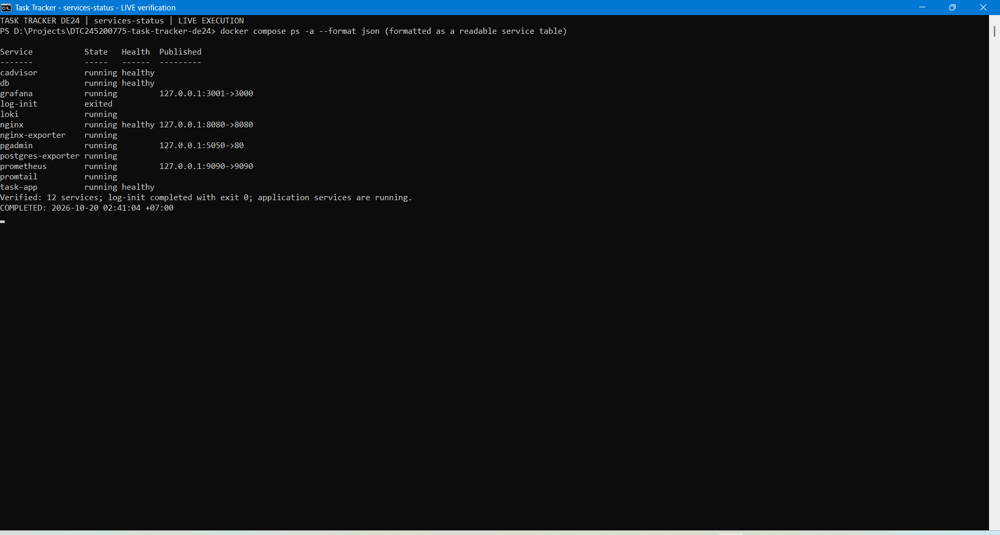
*Hình 1.2. Trạng thái hoạt động của 12 containers sau khi khởi chạy bằng docker compose ps*

Toàn bộ các container nghiệp vụ và hạ tầng dài hạn đều đạt trạng thái `Up (healthy)` hoặc `Up (running)`. Dịch vụ khởi tạo `log-init` được thiết kế chạy quyền root một lần duy nhất (`user: "0:0"`) khi stack khởi động để phân bổ quyền thư mục volume (`chown 10001:10001 /logs/app` và `chown 101:101 /logs/nginx`), sau đó kết thúc nhiệm vụ với mã thoát `0` (`restart: "no"`). Khi quan sát qua lệnh `docker compose ps -a`, trạng thái `Exited (0)` chính là bằng chứng xác nhận `log-init` đã hoàn thành thành công và đúng thiết kế.

<!-- PAGEBREAK -->

# CHƯƠNG 2. CƠ SỞ LÝ THUYẾT NỀN TẢNG

## 2.1 Docker và Docker Compose đa dịch vụ

Docker là nền tảng ảo hóa mức hệ điều hành (containerization) cho phép đóng gói mã nguồn ứng dụng cùng toàn bộ thư viện, biến môi trường và tệp cấu hình phụ thuộc vào một đơn vị độc lập gọi là Image. Khi khởi chạy, Container hoạt động như một tiến trình biệt lập trên máy chủ, sở hữu không gian tên (namespaces) và nhóm điều khiển tài nguyên (cgroups) riêng biệt, loại bỏ hoàn toàn hiện tượng xung đột môi trường ("works on my machine").

Docker Compose là công cụ điều phối đa container thông qua tệp khai báo `docker-compose.yml`. Thay vì khởi động thủ công từng container với hàng loạt tham số dòng lệnh phức tạp, Compose cho phép định nghĩa toàn bộ topology hệ thống gồm các dịch vụ (services), phân vùng mạng ảo (networks), ổ lưu trữ dữ liệu (volumes), biến môi trường và cơ chế kiểm tra sức khỏe tự động (healthcheck) chỉ trong một bản thiết kế duy nhất có thể lưu trữ và quản lý phiên bản cùng mã nguồn dự án.

## 2.2 PostgreSQL và công cụ quản trị cơ sở dữ liệu pgAdmin

PostgreSQL là hệ quản trị cơ sở dữ liệu quan hệ mã nguồn mở (RDBMS) mạnh mẽ, tuân thủ nghiêm ngặt các nguyên tắc ACID (Atomicity, Consistency, Isolation, Durability). PostgreSQL cung cấp hệ thống kiểu dữ liệu phong phú, hỗ trợ khóa chính tự tăng, các ràng buộc toàn vẹn dữ liệu (Check Constraints) và các bộ chỉ mục (B-Tree Indexes) giúp tối ưu hóa tốc độ truy vấn danh mục công việc. Ứng dụng giao tiếp với PostgreSQL thông qua cơ chế truy vấn tham số hóa (Parameterized Queries) của thư viện `pg`, giúp phòng chống và ngăn chặn hiệu quả các nguy cơ tấn công tiêm mã độc SQL Injection.

pgAdmin 4 là giao diện quản trị cơ sở dữ liệu PostgreSQL trực quan trên nền web. Trong kiến trúc container, pgAdmin kết nối tới cơ sở dữ liệu thông qua tên dịch vụ nội bộ `db` trong mạng ảo Docker mà không phụ thuộc vào địa chỉ IP của máy chủ vật lý, tạo điều kiện thuận lợi cho người quản trị theo dõi cấu trúc bảng, kiểm tra chỉ mục và rà soát dữ liệu vận hành.

## 2.3 Nginx Reverse Proxy và bảo vệ tầng biên HTTP

Reverse Proxy là máy chủ trung gian đứng trước một hoặc nhiều máy chủ ứng dụng nội bộ, có nhiệm vụ tiếp nhận yêu cầu từ client trên Internet hoặc mạng ngoài, chuyển tiếp yêu cầu đó tới backend phù hợp và trả kết quả phản hồi lại cho client. Việc sử dụng Nginx Reverse Proxy mang lại các lợi ích an ninh và vận hành cốt lõi:
- **Ẩn giấu máy chủ gốc:** Cổng ứng dụng Node.js (3000) được đóng kín hoàn toàn trong mạng nội bộ, chỉ có Nginx lắng nghe trên cổng biên.
- **Thiết lập hàng rào bảo vệ HTTP:** Nginx bổ sung các tiêu đề an ninh (Security Headers) như Content-Security-Policy (chống XSS), X-Frame-Options (chống Clickjacking) và X-Content-Type-Options (chống MIME sniffing) vào mọi phản hồi HTTP gửi tới trình duyệt người dùng.
- **Quản lý lưu lượng:** Tối ưu hóa timeout kết nối, chuyển tiếp địa chỉ IP thực của client thông qua các tiêu đề `X-Forwarded-For` và `X-Real-IP`.

## 2.4 Hệ thống giám sát metrics Prometheus và Grafana

Prometheus là nền tảng giám sát và cảnh báo mã nguồn mở dựa trên mô hình cơ sở dữ liệu chuỗi thời gian (Time-Series Database — TSDB). Khác với các hệ thống giám sát truyền thống dựa trên cơ chế push (ứng dụng tự gửi tin về server), Prometheus sử dụng cơ chế kéo dữ liệu định kỳ (Pull/Scrape Model). Prometheus định kỳ gửi HTTP GET tới các endpoint `/metrics` của từng mục tiêu (Target) đã được cấu hình, đọc các chuỗi số liệu dạng plain text theo định dạng OpenMetrics và lưu trữ cùng các nhãn định danh (labels).

Các Exporter chuyên dụng đóng vai trò làm cầu nối chuyển đổi các thông số nội bộ của dịch vụ thành định dạng số liệu chuẩn mà Prometheus có thể đọc được:
- `postgres-exporter`: Thu thập số lượng giao dịch, kết nối active, kích thước database.
- `nginx-exporter`: Thu thập trạng thái kết nối và tốc độ xử lý request qua module `stub_status`.
- `cadvisor`: Thu thập mức tiêu thụ CPU, bộ nhớ RAM, lưu lượng mạng và I/O của từng container Docker.

Grafana là nền tảng phân tích và trực quan hóa số liệu hàng đầu. Grafana kết nối trực tiếp tới nguồn dữ liệu Prometheus (Datasource), sử dụng ngôn ngữ truy vấn PromQL để tính toán và hiển thị các đồ thị trực quan (tốc độ request, thời gian trễ p95, trạng thái container) trên bảng điều khiển tương tác.

## 2.5 Thu thập log tập trung với Loki, Promtail và LogQL

Trong kiến trúc đa dịch vụ phân tán, việc phân tích nguyên nhân sự cố thông qua việc đọc tệp log cục bộ trên từng container là vô cùng khó khăn và không thể mở rộng. Giải pháp ghi log tập trung của Grafana Labs gồm hai thành phần cốt lõi:
- **Grafana Loki:** Hệ thống lưu trữ log được tối ưu hóa đặc biệt. Khác với Elasticsearch lập chỉ mục toàn bộ nội dung văn bản (gây tốn kém dung lượng đĩa và RAM), Loki chỉ lập chỉ mục cho siêu dữ liệu (Metadata/Labels) gắn kèm dòng log, còn nội dung log được nén và lưu trữ thành các khối dữ liệu (chunks), giúp tiết kiệm tài nguyên vượt trội.
- **Promtail:** Tác nhân (agent) thu thập log cục bộ. Promtail theo dõi các tệp log được chia sẻ từ volume của ứng dụng và Nginx, trích xuất thông tin, gán nhãn định danh (như `service`, `job`, `level`) và đẩy các bản ghi log về Loki qua giao thức HTTP.
- **LogQL (Log Query Language):** Ngôn ngữ truy vấn chuyên dụng của Loki, cho phép lọc log theo nhãn (Stream selector), lọc theo chuỗi văn bản hoặc phân tích chuyên sâu các trường JSON nội bộ của log.

<!-- PAGEBREAK -->

# CHƯƠNG 3. PHÂN TÍCH VÀ THIẾT KẾ KIẾN TRÚC HỆ THỐNG

## 3.1 Bảng phân công vai trò và thông số dịch vụ

Hệ thống Task Tracker Đề 24 được hợp thành từ 12 dịch vụ Docker Compose. Mỗi dịch vụ đảm nhiệm một chức năng chuyên biệt theo nguyên tắc đơn nhiệm và được cấp phát quyền hạn ở mức tối thiểu. Bảng 3.1 mô tả chi tiết thông số vận hành của từng dịch vụ:

| Tên dịch vụ | Image / Nền tảng | Vai trò và trách nhiệm chính | Cổng nội bộ | Cổng publish ra host | Phân vùng mạng |
|---|---|---|---|---|---|
| `log-init` | `alpine:latest` | Khởi tạo thư mục và phân quyền UID cho volume log trước khi các service chạy | Không có | Không publish | Gắn volume |
| `db` | `postgres:17-alpine` | Cơ sở dữ liệu quan hệ chính, lưu trữ bảng tasks và phân quyền người dùng | 5432/tcp | Không publish | `data` (internal) |
| `task-app` | Node.js 24 Alpine | Ứng dụng Express, cung cấp Web UI, API CRUD và xuất metrics `/metrics` | 3000/tcp | Không publish | `front`, `data`, `observability` |
| `nginx` | `nginx-unprivileged:alpine` | Reverse Proxy tiếp nhận truy cập, security headers, che giấu cổng ứng dụng | 8080/tcp | `127.0.0.1:8080` | `front`, `observability` |
| `pgadmin` | `dpage/pgadmin4:9.10` | Giao diện web quản trị cơ sở dữ liệu PostgreSQL phục vụ kiểm tra dữ liệu | 80/tcp | `127.0.0.1:5050` | `data`, `management` |
| `postgres-exporter` | `postgres-exporter:v0.20.1` | Thu thập metrics hoạt động từ PostgreSQL qua role hạn chế `pg_monitor` | 9187/tcp | Không publish | `data`, `observability` |
| `nginx-exporter` | `nginx-prometheus-exporter:1.5.0` | Đọc thông số kết nối từ `http://nginx:8080/nginx_status` chuyển thành metrics | 9113/tcp | Không publish | `front`, `observability` |
| `cadvisor` | `cadvisor:v0.60.2` | Thu thập tài nguyên phần cứng (CPU, RAM, I/O) của toàn bộ container Docker | 8080/tcp | Không publish | `observability` |
| `prometheus` | `prom/prometheus:v3.15.0` | Máy chủ giám sát TSDB, scrape metrics định kỳ 15s từ 5 jobs | 9090/tcp | `127.0.0.1:9090` | `observability`, `management` |
| `loki` | `grafana/loki:3.7.8` | Máy chủ lưu trữ và lập chỉ mục nhật ký log tập trung | 3100/tcp | Không publish | `observability` |
| `promtail` | `grafana/promtail:3.6.8` | Tác nhân thu thập tệp log từ volume `service_logs` và đẩy về Loki | Không có | Không publish | `observability` |
| `grafana` | `grafana/grafana:13.2.2` | Bảng điều khiển trực quan hóa metrics và giao diện Explore truy vấn LogQL | 3000/tcp | `127.0.0.1:3001` | `observability`, `management` |

*Bảng 3.1. Vai trò, image, cổng nội bộ và cổng publish của các dịch vụ trong hệ thống*

## 3.2 Thiết kế phân tách mạng nội bộ (Network Segmentation)

Nhằm giảm thiểu nguy cơ di chuyển ngang (lateral movement) khi một thành phần bị xâm nhập, hệ thống thiết kế 4 phân vùng mạng Docker riêng biệt với các chính sách định tuyến cụ thể:
1. **Mạng `front` (Bridge):** Mạng kết nối tầng biên giữa Nginx Reverse Proxy và ứng dụng `task-app`, đồng thời có Nginx Exporter để đọc stub status. Đây là mạng bridge thông thường (không bật `internal: true`), cho phép các dịch vụ gắn vào mạng này tiếp nhận kết nối và định tuyến ra ngoài khi cần thiết.
2. **Mạng `data` (Bridge, `internal: true`):** Phân vùng mạng nội bộ chuyên biệt cho dữ liệu, kết nối `task-app`, `db`, `pgadmin` và `postgres-exporter`. Do được bật cờ `internal: true`, Docker không tạo default gateway ra ngoài Internet cho mạng này. Các container chỉ kết nối duy nhất vào mạng `data` (như `db`) sẽ bị cô lập hoàn toàn khỏi Internet, ngăn chặn nguy cơ rò rỉ dữ liệu hoặc tấn công từ bên ngoài. Đối với các container kết nối đồng thời nhiều mạng (như `task-app` nối cả `front`, `pgadmin` nối cả `management`), container có thể định tuyến ra ngoài thông qua giao diện mạng của phân vùng non-internal tương ứng.
3. **Mạng `observability` (Bridge, `internal: true`):** Phân vùng mạng nội bộ chuyên trách giám sát và logging, kết nối `task-app`, `nginx`, các exporters, `cadvisor`, `prometheus`, `loki`, `promtail` và `grafana`. Tương tự mạng `data`, cờ `internal: true` ngăn không cho mạng này làm gateway ra Internet; các container chỉ nằm trong mạng này (như `loki`, `promtail`, `cadvisor`) không có đường ra Internet trực tiếp.
4. **Mạng `management` (Bridge):** Mạng bridge phục vụ giao diện quản trị host loopback cho `pgadmin`, `prometheus` và `grafana`. Các dịch vụ này cần xuất cổng ra `127.0.0.1` của host trên Docker Desktop, đồng thời tham gia mạng dữ liệu hoặc observability tương ứng để đọc số liệu.

Tất cả các cổng dịch vụ công khai ra host (`8080`, `5050`, `9090`, `3001`) đều được cấu hình tường minh gắn vào loopback `127.0.0.1`, tuyệt đối không lắng nghe trên `0.0.0.0`, ngăn chặn việc các thiết bị lạ trong cùng mạng LAN truy cập vào hệ thống demo.

## 3.3 Sơ đồ kiến trúc tổng thể và các luồng dữ liệu

Sơ đồ kiến trúc tại Hình 3.1 được kết xuất trực quan từ bản thiết kế kỹ thuật, thể hiện rõ 3 luồng dữ liệu chính vận hành song song trong hệ thống:
- **Luồng HTTP Request:** Người dùng gửi yêu cầu tới `127.0.0.1:8080`. Nginx tiếp nhận, áp dụng Security Headers và proxy tới `task-app:3000`. Ứng dụng xử lý nghiệp vụ, gửi truy vấn SQL tham số hóa tới `db:5432` bằng role `task_app` và phản hồi kết quả về client.
- **Luồng Scrape Metrics:** Prometheus kích hoạt chu kỳ scrape 15s một lần, gửi HTTP GET tới endpoint metrics của `task-app`, `postgres-exporter`, `nginx-exporter`, `cadvisor` và chính nó. Grafana định kỳ gửi truy vấn PromQL tới Prometheus để vẽ đồ thị.
- **Luồng Centralized Log:** `task-app` ghi log JSON ra `/var/log/app/app.jsonl`; Nginx ghi log ra `/var/log/nginx/access.log`. Promtail gắn volume `service_logs` ở chế độ chỉ đọc (read-only), trích xuất nhãn và gửi log về Loki qua HTTP POST. Người vận hành dùng Grafana Explore gửi LogQL để tra cứu log thời gian thực.

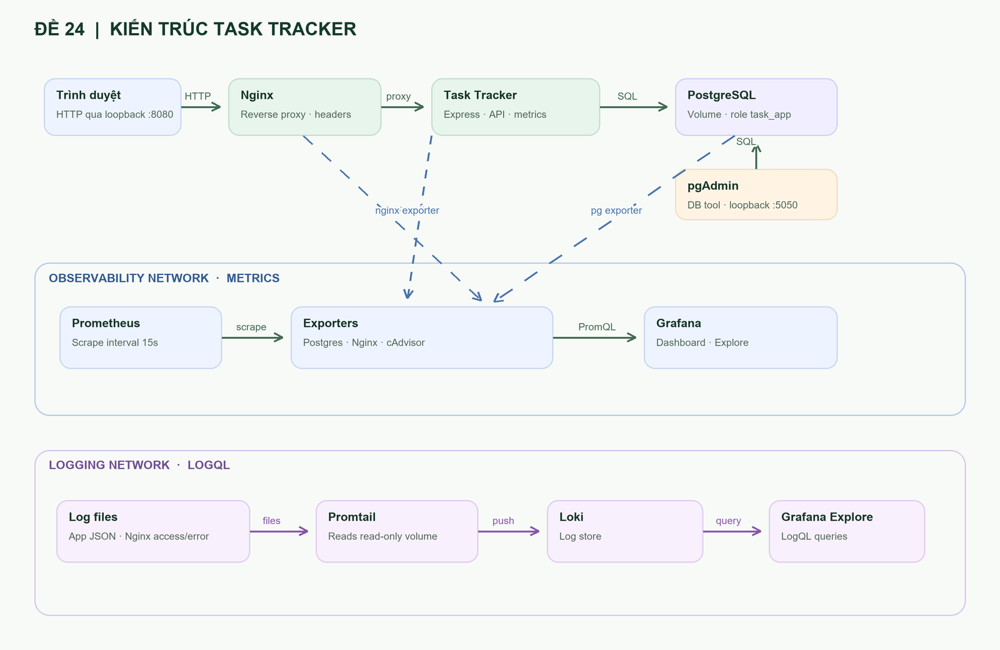
*Hình 3.1. Sơ đồ kiến trúc các thành phần và luồng dữ liệu (HTTP Request, Metrics, Centralized Log)*

<!-- PAGEBREAK -->

# CHƯƠNG 4. XÂY DỰNG ỨNG DỤNG TASK TRACKER VÀ TÍCH HỢP POSTGRESQL

## 4.1 Thiết kế giao diện và trải nghiệm người dùng

Giao diện Task Tracker được xây dựng theo phong cách hiện đại, thanh lịch sử dụng bộ ba công nghệ Web tiêu chuẩn: HTML5 ngữ nghĩa, CSS3 tùy biến cao và Vanilla JavaScript thuần túy (không sử dụng framework nặng như React hay Vue và không cần công đoạn build phức tạp). Thiết kế này giúp ứng dụng tải cực nhanh, dễ bảo trì, dễ giải thích trong môi trường học thuật và tiêu tốn tối thiểu tài nguyên máy chủ.

Giao diện cung cấp các khối thông tin trực quan:
- **Thanh tổng quan và thống kê (Hero & Stat Cards):** Hiển thị số lượng công việc theo từng trạng thái: Tổng số đang theo dõi, Chưa bắt đầu (màu vàng hổ phách), Đang thực hiện (màu xanh dương) và Đã hoàn thành (màu xanh lục).
- **Bộ lọc trạng thái (Status Filter Dropdown):** Cho phép người dùng chuyển đổi nhanh giữa: "Tất cả trạng thái", "Chưa bắt đầu", "Đang thực hiện" và "Đã hoàn thành".
- **Danh sách công việc (Task List Panel):** Hiển thị danh sách thẻ công việc gồm tiêu đề, mô tả tóm tắt, huy hiệu trạng thái (status pill), huy hiệu mức ưu tiên (priority pill: Thấp, Vừa, Cao), hạn hoàn thành, nút đánh dấu hoàn thành nhanh bằng checkbox, cùng hai nút Sửa và Xóa.
- **Biểu mẫu thêm/cập nhật công việc (Task Form Panel):** Biểu mẫu trực quan cho phép nhập tiêu đề (bắt buộc), mô tả chi tiết, hạn hoàn thành (HTML5 date picker), lựa chọn mức ưu tiên và trạng thái. Khi nhấn "Sửa" trên một task, biểu mẫu tự động chuyển sang chế độ cập nhật kèm nút "Hủy".
- **Chống tấn công XSS:** Mọi dữ liệu đầu vào do người dùng nhập đều được xử lý qua hàm `escapeHtml()` trước khi hiển thị ra DOM, đảm bảo an toàn tuyệt đối trước các nguy cơ chèn mã độc HTML/JavaScript.

## 4.2 Lược đồ dữ liệu PostgreSQL và cơ chế Least Privilege

Cơ sở dữ liệu `task_tracker` được khởi tạo tự động thông qua tệp migration SQL `db/migrations/001_tasks.sql`. Cấu trúc chi tiết của bảng `public.tasks` được mô tả trong Bảng 4.1:

| Tên cột | Kiểu dữ liệu | Ràng buộc toàn vẹn | Mục đích lưu trữ |
|---|---|---|---|
| `id` | `BIGSERIAL` | `PRIMARY KEY` | Khóa chính duy nhất của công việc, tự động tăng |
| `title` | `VARCHAR(160)` | `NOT NULL`, `CHECK (length(trim(title)) > 0)` | Tiêu đề công việc, không được để trống hoặc chỉ có khoảng trắng |
| `description` | `TEXT` | `DEFAULT ''`, `CHECK (length(description) <= 4000)` | Mô tả chi tiết nội dung công việc, giới hạn tối đa 4.000 ký tự |
| `due_date` | `DATE` | Có thể nhận giá trị `NULL` | Hạn hoàn thành dự kiến của công việc |
| `status` | `VARCHAR(20)` | `NOT NULL`, `CHECK (status IN ('todo', 'in_progress', 'done'))` | Trạng thái công việc, mặc định là `'todo'` |
| `priority` | `VARCHAR(10)` | `NOT NULL`, `CHECK (priority IN ('low', 'medium', 'high'))` | Mức độ ưu tiên, mặc định là `'medium'` |
| `created_at` | `TIMESTAMPTZ` | `NOT NULL DEFAULT NOW()` | Dấu thời gian hệ thống ghi nhận thời điểm tạo công việc |
| `updated_at` | `TIMESTAMPTZ` | `NOT NULL DEFAULT NOW()` | Dấu thời gian hệ thống cập nhật lần gần nhất |

*Bảng 4.1. Lược đồ cơ sở dữ liệu tasks trong PostgreSQL*

Để tăng tốc độ truy vấn danh sách và bộ lọc, hai chỉ mục tối ưu đã được thiết lập:
- `idx_tasks_status_created_at`: Đánh chỉ mục hỗn hợp trên `(status, created_at DESC)` phục vụ phân trang và lọc theo trạng thái.
- `idx_tasks_due_date`: Đánh chỉ mục trên `due_date` hỗ trợ tìm kiếm và sắp xếp các công việc sắp tới hạn.

Về phân quyền, script khởi tạo database (`db/init/01-create-roles.sh`) tạo ra tài khoản `task_app` dành riêng cho ứng dụng Express với quyền `CONNECT ON DATABASE task_tracker` cùng quyền `USAGE, CREATE ON SCHEMA public`. Quyền `USAGE, CREATE` trên schema `public` là bắt buộc để tiến trình Node.js khi khởi động (`start()` trong `app/src/server.js`) có thể tự động thực thi tệp migration `001_tasks.sql` nhằm khởi tạo bảng `tasks` (`CREATE TABLE IF NOT EXISTS`) và các chỉ mục tối ưu (`CREATE INDEX IF NOT EXISTS`). Tài khoản `task_app` là tài khoản non-superuser (`rolsuper = false`), không có quyền can thiệp vào các schema hệ thống hoặc cấu hình quản trị cụm PostgreSQL, bảo đảm tuân thủ nguyên tắc đặc quyền tối thiểu phù hợp với kiến trúc tự động hóa migration của ứng dụng.

## 4.3 Thao tác thực tế trên giao diện người dùng

### Bước 1: Xem danh mục công việc tổng quan
1. **Mục tiêu:** Kiểm tra khả năng kết nối giữa ứng dụng và PostgreSQL, nạp dữ liệu khởi tạo và hiển thị chính xác các thẻ công việc với đầy đủ trạng thái và mức độ ưu tiên.
2. **Thao tác:** Mở trình duyệt web, truy cập `http://127.0.0.1:8080/`.
3. **Ảnh minh chứng:**

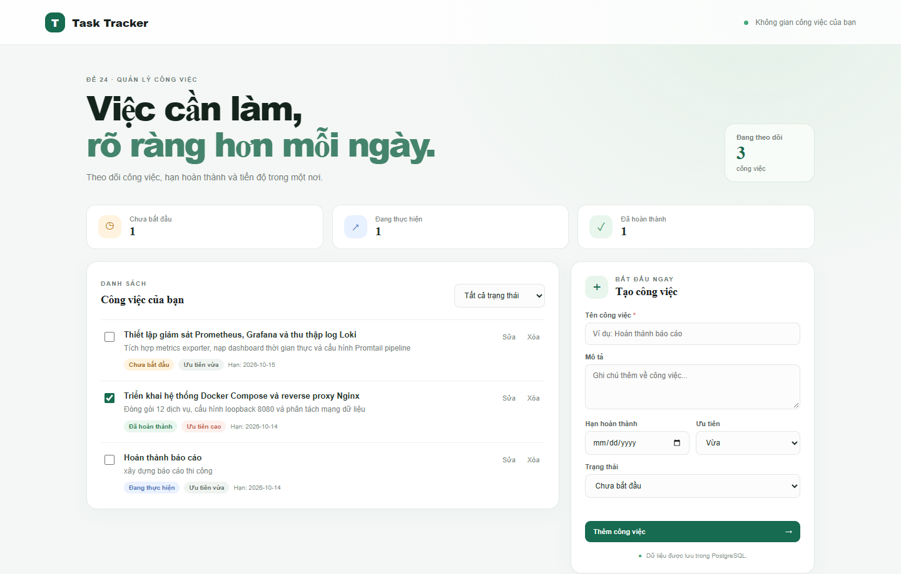
*Hình 4.1. Giao diện Task Tracker tại http://127.0.0.1:8080 với danh sách công việc mẫu đa dạng trạng thái và mức ưu tiên*

4. **Kết quả quan sát và ý nghĩa:** Trang web tải nhanh, hiển thị đầy đủ 3 công việc mẫu với 3 trạng thái phân bổ đồng đều: 1 task Chưa bắt đầu, 1 task Đang thực hiện, 1 task Đã hoàn thành. Các huy hiệu trạng thái và mức ưu tiên được tô màu phân biệt rõ ràng.
5. **Cách tái hiện:** Truy cập `http://127.0.0.1:8080/` trên trình duyệt sau khi stack đã khởi chạy.

### Bước 2: Thao tác tạo công việc mới trên biểu mẫu
1. **Mục tiêu:** Xác minh chức năng nhập liệu, kiểm tra ràng buộc form và gửi yêu cầu tạo task mới.
2. **Thao tác:** Nhập tiêu đề "Thiết lập cảnh báo Alertmanager cho Prometheus", điền mô tả chi tiết, chọn hạn hoàn thành "2026-10-28", chọn mức ưu tiên "Cao" và trạng thái "Đang thực hiện", sau đó nhấn "Thêm công việc".
3. **Ảnh minh chứng:**

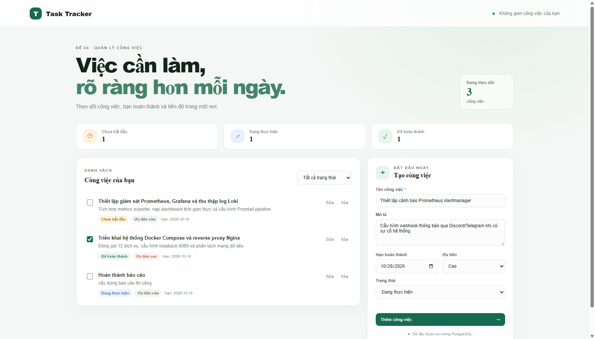
*Hình 4.2. Thao tác nhập liệu và tạo công việc mới trên biểu mẫu giao diện người dùng*

4. **Kết quả quan sát và ý nghĩa:** Biểu mẫu phản hồi mượt mà, nhận đúng các giá trị chọn từ dropdown và date picker. Khi gửi form, ứng dụng phát sinh request HTTP POST `/api/tasks` trả về mã `201 Created` và tự động cập nhật danh sách hiển thị.
5. **Cách tái hiện:** Điền thông tin vào form "Bắt đầu ngay" ở khung bên phải và nhấn nút "Thêm công việc".

### Bước 3: Lọc danh sách công việc theo trạng thái
1. **Mục tiêu:** Kiểm tra tính năng lọc dữ liệu phía client và API backend khi người dùng thay đổi tiêu chí lựa chọn.
2. **Thao tác:** Tại dropdown "Lọc trạng thái", chọn mục "Đang thực hiện".
3. **Ảnh minh chứng:**

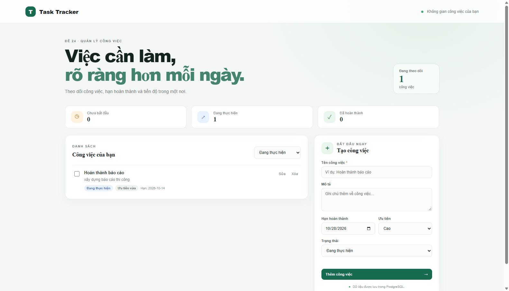
*Hình 4.3. Tính năng lọc danh sách công việc theo trạng thái ("Đang thực hiện") trên giao diện web*

4. **Kết quả quan sát và ý nghĩa:** Danh sách công việc ngay lập tức được cập nhật: chỉ còn hiển thị duy nhất công việc có trạng thái "Đang thực hiện" ("Hoàn thành báo cáo"), bộ đếm "Đang theo dõi" cập nhật về 1 công việc, các task khác được ẩn đi chính xác.
5. **Cách tái hiện:** Thay đổi giá trị của dropdown filter trên giao diện và quan sát danh sách tự động cập nhật.

## 4.4 Kiểm thử tự động End-to-End (E2E) API CRUD qua Nginx

1. **Mục tiêu:** Kiểm chứng toàn diện chu trình xử lý của API thông qua Nginx Reverse Proxy: kiểm tra trạng thái sức khỏe (`GET /health`), tạo công việc có mã nhận diện riêng (`POST`), tìm kiếm và lọc (`GET ?q=...`), cập nhật trạng thái (`PATCH`), xóa công việc (`DELETE`), kiểm tra mã `404` khi thao tác trên task đã xóa, và kiểm tra cơ chế từ chối dữ liệu không hợp lệ / JSON hỏng với mã `400 Bad Request`.
2. **Lệnh thực hiện:**
```powershell
node scripts/verify_e2e.js
```
3. **Ảnh minh chứng:**

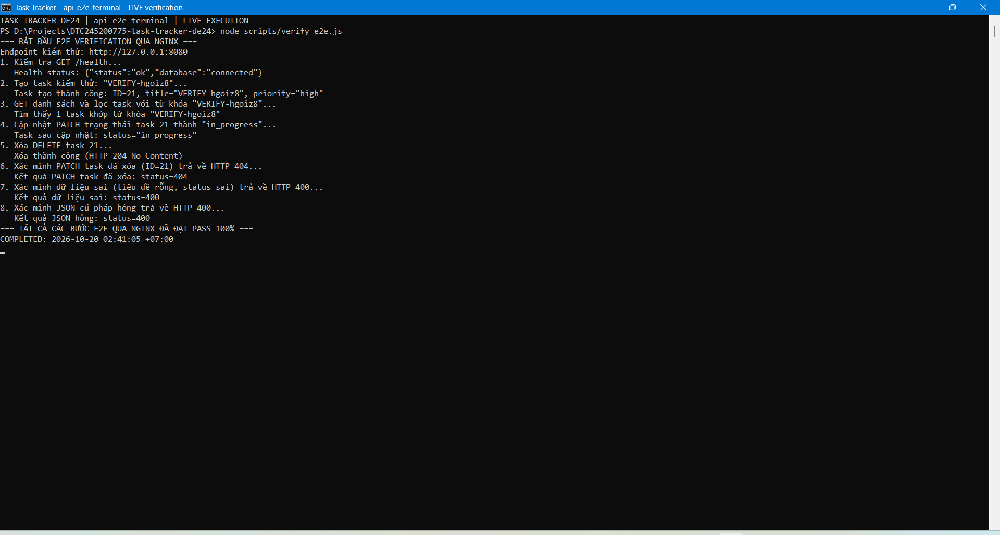
*Hình 4.4. Ảnh chụp cửa sổ PowerShell ghi nhận kết quả thực thi kiểm thử tự động End-to-End (E2E) các API CRUD qua Nginx trên terminal*

4. **Kết quả quan sát và ý nghĩa:**
- `GET /health` trả về mã HTTP `200` kèm JSON xác nhận database đã kết nối (`{"status":"ok","database":"connected"}`).
- `POST /api/tasks` tạo thành công task kiểm thử với mã `201 Created` và ID tự tăng được lưu vào database.
- `GET /api/tasks?q=...` tìm thấy chính xác bản ghi khớp từ khóa vừa tạo.
- `PATCH /api/tasks/:id` cập nhật trạng thái thành `"in_progress"` thành công với mã `200 OK`.
- `DELETE /api/tasks/:id` xóa bản ghi thành công với mã `204 No Content`. (Lưu ý: trong access log Nginx ở Chương 7, dòng `DELETE` xuất hiện mã `404` là từ một yêu cầu dọn dẹp gửi lại sau khi task đã bị xóa trước đó, minh chứng API từ chối chuẩn xác khi thao tác trên bản ghi không còn tồn tại).
- `PATCH /api/tasks/:id` sau khi đã xóa trả về mã `404 Not Found` chuẩn RESTful.
- Dữ liệu thiếu tiêu đề hoặc JSON cú pháp hỏng bị từ chối với mã `400 Bad Request`, không gây crash server hay rò rỉ mã nguồn.
- Toàn bộ 8/8 bước kiểm thử E2E đạt PASS 100%.

Dữ liệu đầu ra thô (raw terminal output) ghi nhận từ phiên thực thi (được lưu tại `docs/logs/verify_e2e.log`):
```text
Captured live: 2026-10-20 02:41:05 +07:00
TASK TRACKER DE24 | api-e2e-terminal | LIVE EXECUTION
PS D:\Projects\DTC245200775-task-tracker-de24> node scripts/verify_e2e.js
=== BẮT ĐẦU E2E VERIFICATION QUA NGINX ===
Endpoint kiểm thử: http://127.0.0.1:8080
1. Kiểm tra GET /health...
   Health status: {"status":"ok","database":"connected"}
2. Tạo task kiểm thử: "VERIFY-hgoiz8"...
   Task tạo thành công: ID=21, title="VERIFY-hgoiz8", priority="high"
3. GET danh sách và lọc task với từ khóa "VERIFY-hgoiz8"...
   Tìm thấy 1 task khớp từ khóa "VERIFY-hgoiz8"
4. Cập nhật PATCH trạng thái task 21 thành "in_progress"...
   Task sau cập nhật: status="in_progress"
5. Xóa DELETE task 21...
   Xóa thành công (HTTP 204 No Content)
6. Xác minh PATCH task đã xóa (ID=21) trả về HTTP 404...
   Kết quả PATCH task đã xóa: status=404
7. Xác minh dữ liệu sai (tiêu đề rỗng, status sai) trả về HTTP 400...
   Kết quả dữ liệu sai: status=400
8. Xác minh JSON cú pháp hỏng trả về HTTP 400...
   Kết quả JSON hỏng: status=400
=== TẤT CẢ CÁC BƯỚC E2E QUA NGINX ĐÃ ĐẠT PASS 100% ===
COMPLETED: 2026-10-20 02:41:05 +07:00
```
5. **Cách tái hiện:** Thực thi tệp `scripts/verify_e2e.js` bằng Node.js khi stack đang hoạt động.

## 4.5 Quản trị và truy vấn PostgreSQL qua giao diện web pgAdmin 4

1. **Mục tiêu:** Xác minh khả năng kết nối của công cụ quản trị web pgAdmin 4 tới dịch vụ cơ sở dữ liệu `db` trong mạng nội bộ Docker và kiểm tra sự toàn vẹn của dữ liệu trong bảng `public.tasks`.
2. **Thao tác:** Mở trình duyệt tại `http://127.0.0.1:5050`, đăng nhập bằng tài khoản được cấu hình trong `.env`, mở Query Tool và thực thi câu lệnh SQL:
```sql
SELECT * FROM public.tasks ORDER BY id ASC;
```
3. **Ảnh minh chứng:**

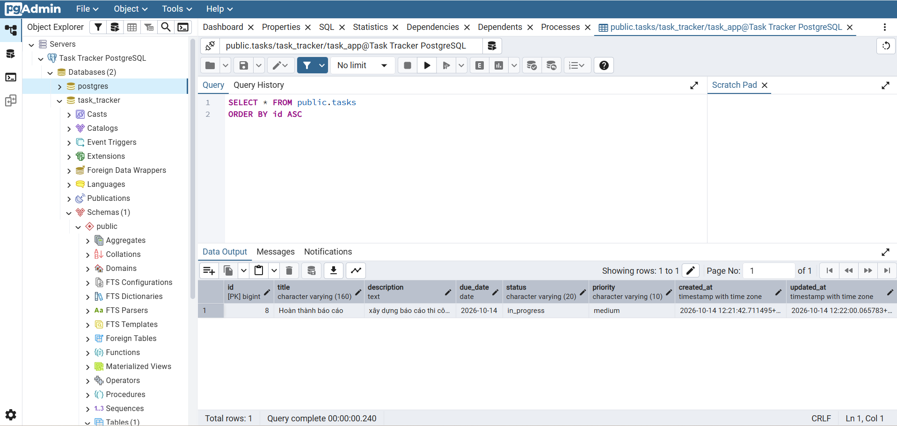
*Hình 4.5. Giao diện pgAdmin 4 kết nối cơ sở dữ liệu task_tracker và hiển thị bảng public.tasks*

4. **Kết quả quan sát và ý nghĩa:**
pgAdmin tự động nạp cấu hình server `Task Tracker PostgreSQL` thông qua tệp `servers.json`, kết nối thành công tới host `db:5432`. Kết quả truy vấn SQL hiển thị đầy đủ các cột dữ liệu (`id`, `title`, `description`, `due_date`, `status`, `priority`, `created_at`, `updated_at`). Dữ liệu được lưu trữ đúng chuẩn múi giờ và kiểu dữ liệu quy định.
5. **Cách tái hiện:** Truy cập `http://127.0.0.1:5050`, đăng nhập bằng `PGADMIN_EMAIL` và `PGADMIN_PASSWORD` từ `.env`, điều hướng tới Object Explorer > Servers > Task Tracker PostgreSQL > Databases > task_tracker > Schemas > public > Tables > tasks, mở View/Edit Data.

<!-- PAGEBREAK -->

# CHƯƠNG 5. NGINX REVERSE PROXY VÀ BẢO VỆ HTTP

## 5.1 Cấu hình Gateway và che giấu máy chủ ứng dụng nội bộ

Trong kiến trúc triển khai thực tế, việc để máy chủ ứng dụng (như Node.js Express) trực tiếp lắng nghe yêu cầu từ bên ngoài tiềm ẩn nhiều rủi ro an ninh nghiêm trọng. Máy chủ ứng dụng thường không được tối ưu hóa cho việc xử lý kết nối đồng thời số lượng lớn, dễ bị tấn công từ chối dịch vụ (DoS), và việc để lộ cổng ứng dụng ra ngoài giúp kẻ tấn công dễ dàng xác định được công nghệ nền tảng (fingerprinting).

Nginx được cấu hình làm Reverse Proxy đứng ở tuyến đầu, đóng vai trò là điểm tiếp nhận duy nhất cho mọi yêu cầu HTTP hướng tới ứng dụng. Trong `docker-compose.yml`, dịch vụ `nginx` sử dụng image unprivileged (`nginxinc/nginx-unprivileged:alpine3.24`), chỉ công khai cổng `8080` gắn với loopback `127.0.0.1`. Cổng `3000` của Node.js chỉ được khai báo trong chỉ thị `expose`, hoàn toàn không có port mapping ra máy chủ host.

Khi tiếp nhận request, Nginx thực hiện:
- Chuyển tiếp yêu cầu qua chỉ thị `proxy_pass http://task-app:3000`.
- Thiết lập các tiêu đề ủy quyền: `Host $host`, `X-Real-IP $remote_addr`, `X-Forwarded-For $proxy_add_x_forwarded_for`, và `X-Forwarded-Proto $scheme`.
- Gán mã định danh duy nhất cho từng yêu cầu (`X-Request-Id $request_id`) giúp đồng bộ hóa vết vết giữa log của Nginx và log của ứng dụng Express.
- Giới hạn thời gian kết nối nội bộ (`proxy_connect_timeout 5s; proxy_read_timeout 60s;`) để ngăn chặn việc chiếm dụng tài nguyên kéo dài khi ứng dụng gặp sự cố.

## 5.2 Phân tích chi tiết 5 HTTP Security Headers

Nhằm gia cố an ninh ở tầng trình duyệt, Nginx được cấu hình bổ sung 5 HTTP Security Headers tiêu chuẩn vào mọi phản hồi trả về cho client. Bảng 5.1 phân tích chi tiết cấu hình và cơ chế phòng vệ của từng header:

| Tên Header | Giá trị cấu hình | Cơ chế bảo vệ và mục đích an ninh |
|---|---|---|
| `Content-Security-Policy` | `default-src 'self'; script-src 'self'; style-src 'self'; img-src 'self' data:; connect-src 'self'; object-src 'none'; base-uri 'self'; frame-ancestors 'none'` | Chính sách an ninh nội dung nghiêm ngặt. Chỉ cho phép tải mã kịch bản, stylesheet, ảnh và kết nối API từ chính origin hiện tại (`'self'`). Chặn đứng hoàn toàn nguy cơ tấn công Cross-Site Scripting (XSS) và tiêm script từ máy chủ của kẻ tấn công. |
| `X-Frame-Options` | `DENY` | Nghiêm cấm tuyệt đối việc nhúng trang web Task Tracker vào bất kỳ thẻ `<iframe>`, `<frame>` hoặc `<object>` nào trên một trang web khác. Ngăn chặn triệt để hình thức tấn công đánh cắp thao tác nhấp chuột (Clickjacking). |
| `X-Content-Type-Options` | `nosniff` | Yêu cầu trình duyệt luôn tuân thủ chính xác kiểu MIME được khai báo trong tiêu đề `Content-Type`, ngăn chặn cơ chế tự động suy đoán kiểu nội dung (MIME Sniffing), phòng ngừa việc trình duyệt thực thi mã độc ẩn trong tệp văn bản hoặc hình ảnh. |
| `Referrer-Policy` | `strict-origin-when-cross-origin` | Kiểm soát thông tin địa chỉ trang nguồn gửi kèm trong header `Referer`. Khi điều hướng ra ngoài origin khác qua HTTPS, chỉ gửi tên miền origin chứ không gửi toàn bộ URL chứa tham số truy vấn nhạy cảm. |
| `Permissions-Policy` | `camera=(), microphone=(), geolocation=()` | Vô hiệu hóa hoàn toàn quyền truy cập của trình duyệt vào các phần cứng nhạy cảm gồm máy ảnh (camera), micrô (microphone) và định vị vị trí địa lý (geolocation), giảm thiểu tối đa bề mặt tấn công. |

*Bảng 5.1. Chi tiết 5 HTTP Security Headers thiết lập trên Nginx Reverse Proxy*

## 5.3 Giải thích phương án thiết kế cổng và lựa chọn giao thức

Đề tài cho phép hai phương án triển khai ở tầng vận chuyển: thiết lập HTTPS với chứng chỉ tự ký (Self-Signed Certificate) hoặc duy trì HTTP kèm bộ Security Headers hoàn chỉnh trên cổng loopback `8080`.

Hệ thống Task Tracker Đề 24 lựa chọn phương án duy trì HTTP trên loopback `127.0.0.1:8080` kết hợp cấu hình đầy đủ 5 Security Headers vì các lý do thực tế sau:
1. Trong môi trường demo cục bộ (localhost), việc sử dụng chứng chỉ SSL tự ký thường gây ra cảnh báo bảo mật màu đỏ ("Untrusted Certificate / Your connection is not private") trên các trình duyệt hiện đại (Chrome, Edge), gây gián đoạn quy trình chấm thi và kiểm thử tự động của các công cụ như cURL hay fetch.
2. Cổng dịch vụ được cô lập tuyệt đối trên địa chỉ loopback `127.0.0.1`, không lắng nghe trên giao diện mạng công cộng, do đó lưu lượng không truyền qua mạng vật lý ngoài máy chủ.
3. Trong báo cáo kỹ thuật và tài liệu vận hành, hệ thống được ghi rõ ràng và trung thực là `http://localhost:8080`, tuyệt đối không ghi nhận sai lệch thành HTTPS khi chưa triển khai chứng chỉ tin cậy (CA-signed). Khi đưa hệ thống lên môi trường Internet thực tế, việc bổ sung Let's Encrypt TLS và cấu hình HSTS (HTTP Strict Transport Security) sẽ được thực hiện dễ dàng trên Nginx mà không cần thay đổi kiến trúc ứng dụng.

## 5.4 Kiểm tra thực nghiệm Response Headers bằng cURL

1. **Mục tiêu:** Xác minh Nginx tiếp nhận yêu cầu trên cổng 8080 và trả về đầy đủ 5 tiêu đề an ninh theo đúng cấu hình.
2. **Lệnh thực hiện:**
```powershell
curl.exe -i http://127.0.0.1:8080/
```
3. **Ảnh minh chứng:**

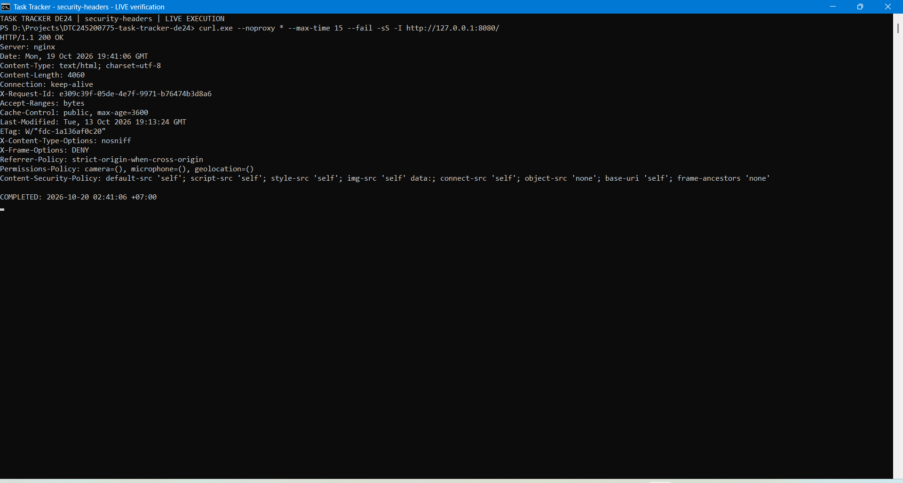
*Hình 5.1. Kiểm tra response headers bảo mật của website qua Nginx bằng curl.exe -i*

4. **Kết quả quan sát và ý nghĩa:**
Phản hồi từ Nginx trả về mã HTTP `200 OK`, định danh máy chủ `Server: nginx`, kèm theo mã định danh yêu cầu `X-Request-Id` và toàn bộ 5 tiêu đề an ninh:
- `Content-Security-Policy: default-src 'self'; ...`
- `X-Frame-Options: DENY`
- `X-Content-Type-Options: nosniff`
- `Referrer-Policy: strict-origin-when-cross-origin`
- `Permissions-Policy: camera=(), microphone=(), geolocation=()`
Kết quả này khẳng định hệ thống tệp tĩnh và proxy của Nginx đã được gia cố an ninh vững chắc theo đúng yêu cầu đề tài.
5. **Cách tái hiện:** Mở PowerShell trên máy host và chạy lệnh `curl.exe -i http://127.0.0.1:8080/`.

<!-- PAGEBREAK -->

# CHƯƠNG 6. GIÁM SÁT HỆ THỐNG BẰNG PROMETHEUS VÀ GRAFANA

## 6.1 Cơ chế Scrape Metrics và quy hoạch Jobs

Hệ thống giám sát hiệu năng được xây dựng xoay quanh máy chủ Prometheus v3.15. Prometheus hoạt động theo cơ chế pull-based với chu kỳ thu thập dữ liệu (scrape interval) mặc định là 15 giây. File cấu hình `monitoring/prometheus/prometheus.yml` quy định 5 jobs giám sát độc lập, bao quát toàn bộ các tầng trong kiến trúc ứng dụng.

Chi tiết các mục tiêu giám sát được mô tả trong Bảng 6.1:

| Tên Scrape Job | Địa chỉ Endpoint nội bộ | Exporter / Nền tảng | Thông số thu thập chính | Trạng thái thực tế |
|---|---|---|---|---|
| `prometheus` | `localhost:9090` | Prometheus Internal | Dung lượng TSDB, tốc độ nạp mẫu (samples ingested), thời gian thực thi câu truy vấn | UP (1/1) |
| `task_tracker_app` | `task-app:3000/metrics` | Node.js prom-client | Tổng số request theo route/status, thời gian xử lý (histogram), bộ nhớ heap, GC latency | UP (1/1) |
| `postgres` | `postgres-exporter:9187` | Postgres Exporter v0.20 | Trạng thái `pg_up`, số giao dịch commit/rollback, kích thước database, kết nối active | UP (1/1) |
| `nginx` | `nginx-exporter:9113` | Nginx Exporter v1.5 | Kết nối client đang hoạt động (active), số kết nối accepted/handled, tốc độ xử lý request | UP (1/1) |
| `containers` | `cadvisor:8080` | Google cAdvisor v0.60 | Phần trăm sử dụng CPU, dung lượng RAM sử dụng, thông lượng mạng và I/O từng container | UP (1/1) |

*Bảng 6.1. Danh sách các scrape jobs và exporters trong Prometheus*

## 6.2 Cấu hình Metrics ứng dụng chuyên biệt

Trong ứng dụng Node.js Express (`app/src/metrics.js`), thư viện `prom-client` được tích hợp để sinh ra cả metrics mặc định của Node.js lẫn các metrics nghiệp vụ chuyên biệt:
- `task_tracker_http_requests_total`: Metric kiểu Counter ghi nhận tổng số lượng yêu cầu HTTP đã phục vụ, được gắn các nhãn (labels): `method` (GET, POST, PATCH, DELETE), `route` (ví dụ: `/api/tasks`, `/api/tasks/:id`, `/health`), và `status_code` (200, 201, 204, 400, 404, 500). Việc chuẩn hóa nhãn `route` thành dạng mẫu (parameterized pattern) thay vì gán trực tiếp ID động của từng task (như `/api/tasks/12`) là nguyên tắc quan trọng nhằm tránh nguy cơ bùng nổ số lượng nhãn (High Cardinality Explosion), bảo vệ bộ nhớ của Prometheus.
- `task_tracker_http_request_duration_seconds`: Metric kiểu Histogram đo lường thời gian trễ xử lý yêu cầu tính bằng giây, chia theo các khoảng (buckets: `0.005, 0.01, 0.025, 0.05, 0.1, 0.25, 0.5, 1, 2.5`), hỗ trợ tính toán thời gian trễ trung bình và các mức phân vị (Percentiles: p50, p90, p95, p99).
- Node.js Default Metrics: Tự động thu thập mức tiêu thụ heap memory (`nodejs_heap_size_used_bytes`), dung lượng bộ nhớ tiến trình (`process_resident_memory_bytes`), độ trễ vòng lặp sự kiện Event Loop (`nodejs_eventloop_lag_seconds`) và tần suất dọn rác bộ nhớ (Garbage Collection).

## 6.3 Kiểm tra trạng thái Prometheus Targets

1. **Mục tiêu:** Xác minh Prometheus kết nối thành công tới toàn bộ 5 endpoint giám sát, không có endpoint nào bị gián đoạn hay trả về lỗi mạng.
2. **Thao tác:** Mở trình duyệt web, truy cập `http://127.0.0.1:9090/targets`.
3. **Ảnh minh chứng:**

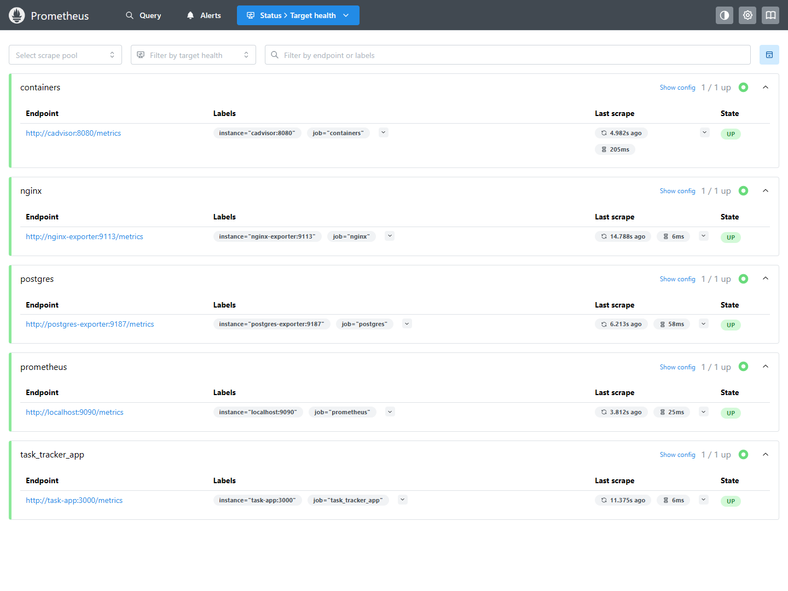
*Hình 6.1. Trạng thái 5/5 Prometheus Targets đạt UP 100% tại http://127.0.0.1:9090/targets*

4. **Kết quả quan sát và ý nghĩa:**
Toàn bộ 5 scrape pools (`containers`, `nginx`, `postgres`, `prometheus`, `task_tracker_app`) đều hiển thị trạng thái `1/1 up` với biểu tượng màu xanh lá. Thời gian thực thi scrape (scrape duration) dao động từ 2ms đến 110ms, cho thấy mạng nội bộ `observability` hoạt động thông suốt và các exporter phản hồi nhanh chóng.
5. **Cách tái hiện:** Truy cập URL `http://127.0.0.1:9090/targets` trên trình duyệt sau khi stack khởi chạy được ít nhất 30 giây.

## 6.4 Truy vấn dữ liệu Metric ứng dụng trên Prometheus Graph

1. **Mục tiêu:** Kiểm tra khả năng thu thập và vẽ đồ thị chuỗi thời gian của metric nghiệp vụ `task_tracker_http_requests_total`.
2. **Thao tác:** Truy cập `http://127.0.0.1:9090/graph`, nhập câu truy vấn PromQL:
```promql
task_tracker_http_requests_total
```
chọn tab Graph với khoảng thời gian 1 giờ và nhấn Execute.
3. **Ảnh minh chứng:**

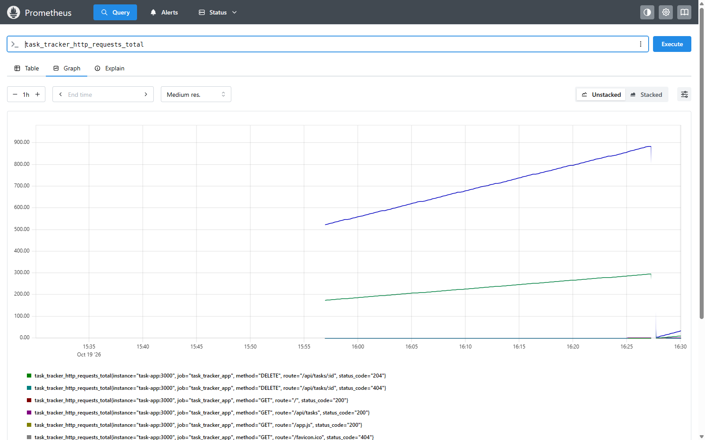
*Hình 6.2. Đồ thị truy vấn metric ứng dụng task_tracker_http_requests_total trên Prometheus Graph*

4. **Kết quả quan sát và ý nghĩa:**
Prometheus vẽ đầy đủ các đường biểu diễn số lượng request tăng dần theo thời gian. Bảng chú giải (legend) phía dưới thể hiện rõ từng series phân tách theo nhãn `method`, `route` và `status_code` (bao gồm các mã thành công `200`, `201`, `204` và các mã lỗi `400`, `404` phát sinh trong quá trình kiểm thử E2E).
5. **Cách tái hiện:** Nhập biểu thức PromQL trên vào ô tìm kiếm của giao diện Prometheus Graph và chọn chế độ biểu đồ.

## 6.5 Trực quan hóa số liệu trên Grafana Dashboard

1. **Mục tiêu:** Kiểm chứng bảng điều khiển "Task Tracker Overview" được nạp tự động (Provisioned Dashboard) hiển thị trực quan các thông số tổng hợp của hệ thống.
2. **Thao tác:** Mở trình duyệt tại `http://127.0.0.1:3001`, đăng nhập bằng tài khoản quản trị từ `.env`, điều hướng tới Dashboards > Task Tracker > Task Tracker Overview.
3. **Ảnh minh chứng:**

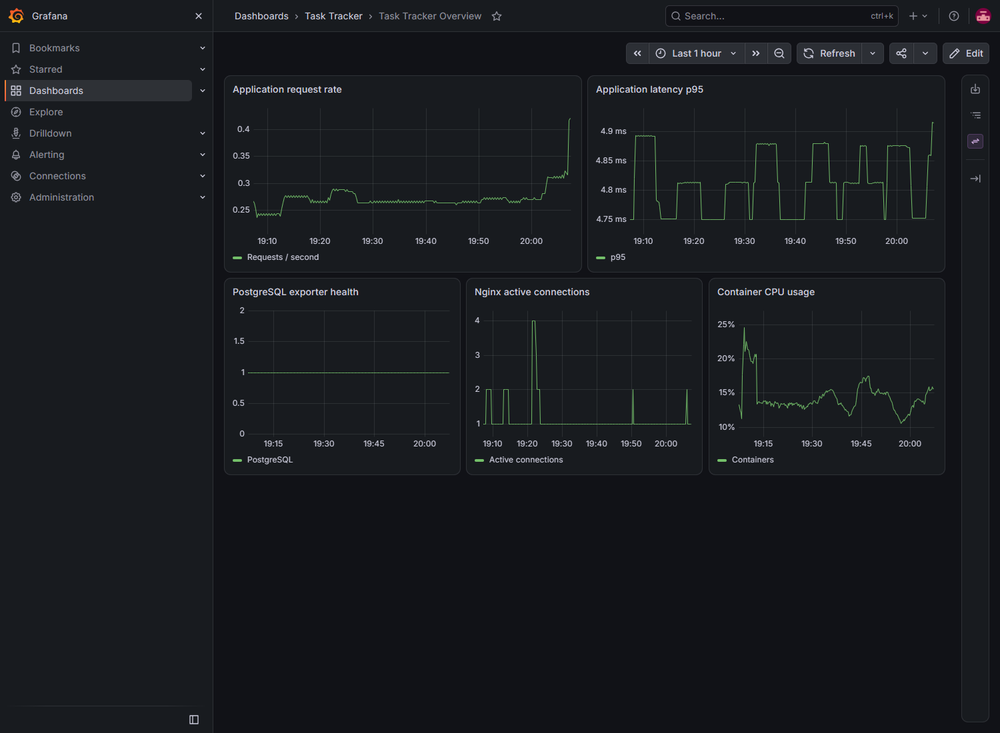
*Hình 6.3. Dashboard giám sát trực quan hóa "Task Tracker Overview" trên Grafana theo thời gian thực*

4. **Kết quả quan sát và ý nghĩa:**
Bảng điều khiển hiển thị 5 đồ thị quan trọng:
- **Application request rate:** Tốc độ yêu cầu HTTP trung bình (requests/second) tính bằng hàm `rate()`.
- **Application latency p95:** Thời gian phản hồi phân vị thứ 95 của ứng dụng duy trì ổn định ở mức dưới 5.0ms.
- **PostgreSQL exporter health:** Trạng thái cơ sở dữ liệu duy trì giá trị `pg_up = 1` liên tục.
- **Nginx active connections:** Số lượng kết nối client đồng thời được Nginx xử lý.
- **Container CPU usage:** Tỷ lệ phần trăm tài nguyên vi xử lý do các container tiêu thụ, phản ánh tải hệ thống ổn định trong ngưỡng an toàn.
5. **Cách tái hiện:** Đăng nhập Grafana tại cổng 3001 và mở dashboard đã được provision sẵn.

<!-- PAGEBREAK -->

# CHƯƠNG 7. THU THẬP VÀ TẬP TRUNG LOG VỚI LOKI, PROMTAIL VÀ LOGQL

## 7.1 Chuỗi thu thập Log và thiết lập Volume chia sẻ

Nhằm đảm bảo tính minh bạch và khả năng truy vết lỗi mà không làm gián đoạn hiệu năng của ứng dụng, hệ thống áp dụng mô hình thu thập nhật ký bất đồng bộ thông qua tệp tin và volume chia sẻ:
1. **Phía ứng dụng Express:** Sử dụng thư viện ghi log hiệu năng cao `pino`. Mọi sự kiện phát sinh (khởi động server, hoàn tất request HTTP, cảnh báo xác thực, lỗi cơ sở dữ liệu) đều được chuyển đổi thành cấu trúc JSON chuẩn mực và ghi nối tiếp vào tệp `/var/log/app/app.jsonl`.
2. **Phía Nginx Reverse Proxy:** Nginx ghi nhật ký truy cập vào tệp `/var/log/nginx/access.log` và nhật ký lỗi vào `/var/log/nginx/error.log`.
3. **Phân quyền Volume (`log-init`):** Docker volume mang tên `service_logs` được chia sẻ giữa các container. Container khởi tạo `log-init` chạy trước nhất, tạo các thư mục `/logs/app` (gán quyền sở hữu UID 10001 của node user) và `/logs/nginx` (gán quyền sở hữu UID 101 của nginx user).
4. **Phía Promtail:** Promtail gắn volume `service_logs` vào đường dẫn `/var/log/collected` ở chế độ **chỉ đọc (`:ro`)**. Promtail đọc đuôi tệp (tailing), thực thi pipeline bóc tách dữ liệu và đẩy về Loki qua giao thức HTTP endpoint `http://loki:3100/loki/api/v1/push`.

## 7.2 Phân tích nhãn và cấu hình Pipeline Promtail

Tệp cấu hình `monitoring/promtail/config.yml` định nghĩa các scrape configs tương ứng cho hai nguồn log:
- **Nguồn log ứng dụng (`app.jsonl`):** Sử dụng stage `json` của Promtail để đọc các trường dữ liệu nội bộ. Trích xuất mức log số học (`level`) của Pino, ánh xạ thành nhãn `level_extracted`, bổ sung các nhãn tĩnh `service="task-tracker"` và `job="task_tracker_app"`.
- **Nguồn log Nginx (`access.log`):** Gán nhãn `service="nginx"`, `job="nginx_access"`, `log_type="access"`.

Nhờ việc gán nhãn có cấu trúc, các kỹ sư vận hành có thể nhanh chóng thu hẹp không gian tìm kiếm nhật ký mà không cần duyệt qua hàng triệu dòng log thô.

## 7.3 Ba mẫu truy vấn LogQL chi tiết và ý nghĩa

Bảng 7.1 trình bày chi tiết ba mẫu truy vấn LogQL được thiết kế cho hệ thống Task Tracker, giải thích cú pháp và kết quả ghi nhận thực tế:

| TT | Biểu thức truy vấn LogQL | Mục đích phân tích vận hành | Kết quả thực nghiệm ghi nhận |
|---|---|---|---|
| 1 | `{service="task-tracker"} \| json` | Trích xuất toàn bộ nhật ký ứng dụng và tự động phân giải các trường JSON (như `requestId`, `method`, `path`, `statusCode`, `durationMs`) thành các thuộc tính có thể lọc. | Trả về các dòng log JSON hoàn chỉnh của ứng dụng, hiển thị rõ request ID và thời gian xử lý từng request (1ms). |
| 2 | `{service="task-tracker"} \| json \| statusCode >= 200 and statusCode < 300` *(Lưu ý: nếu chỉ dùng `statusCode >= 200`, bộ lọc sẽ bao gồm cả mã lỗi 4xx và 5xx)* | Sàng lọc các bản ghi yêu cầu HTTP thành công (dải 2xx: 200 OK, 201 Created, 204 No Content). Để lọc riêng lỗi, dùng `{service="task-tracker"} \| json \| level="50"` hoặc `statusCode >= 400`. | Sàng lọc chính xác các yêu cầu thành công, loại trừ hoàn toàn các mã lỗi phát sinh khi client gửi dữ liệu sai hoặc thao tác kiểm thử. |
| 3 | `{service="nginx", log_type="access"} \|= "/api/tasks"` | Lọc toàn bộ access log của Nginx Reverse Proxy có chứa chuỗi đường dẫn `/api/tasks` để theo dõi các thao tác CRUD từ phía biên mạng. | Trả về danh sách các bản ghi truy cập Nginx kèm IP nguồn, phương thức HTTP, endpoint `/api/tasks`, mã HTTP và thời gian phản hồi. |

*Bảng 7.1. Ba mẫu truy vấn LogQL, mục đích phân tích và kết quả thực nghiệm*

## 7.4 Thực thi truy vấn LogQL trên Grafana Explore

1. **Mục tiêu:** Kiểm tra khả năng tra cứu và tương quan hóa nhật ký log trên giao diện người dùng trực quan của Grafana Explore.
2. **Thao tác:** Truy cập `http://127.0.0.1:3001/explore`, chọn nguồn dữ liệu `Loki`, nhập biểu thức LogQL và thực thi truy vấn.
3. **Ảnh minh chứng:**

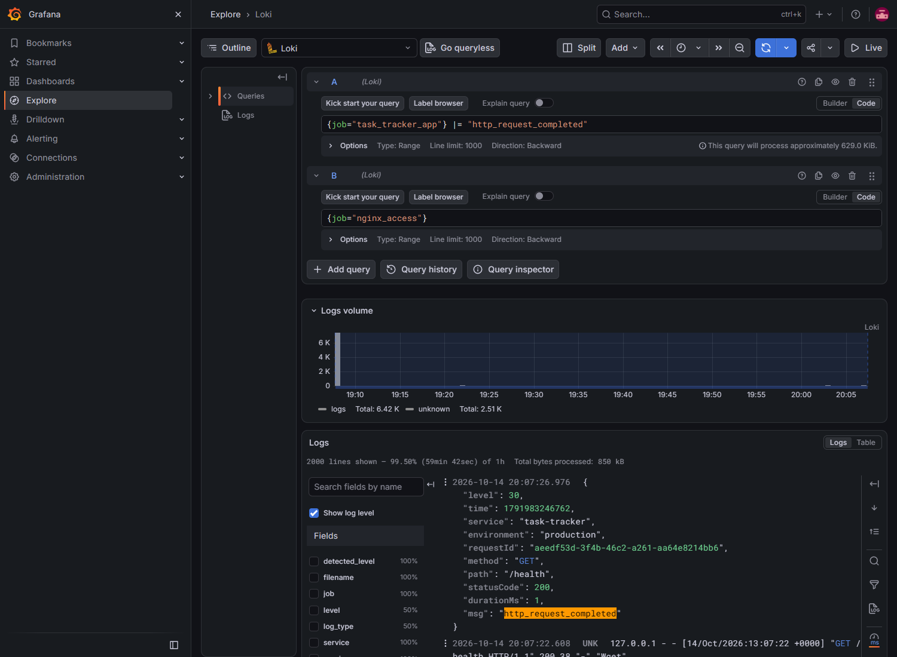
*Hình 7.1. Giao diện Grafana Explore truy vấn tập trung log ứng dụng và Nginx qua datasource Loki*

4. **Kết quả quan sát và ý nghĩa:**
Giao diện hiển thị biểu đồ tần suất log (Logs Volume Histogram) phân bổ trực quan theo thời gian. Phía dưới là danh sách các dòng log chi tiết, cho phép mở rộng (expand) từng bản ghi để kiểm tra toàn bộ cấu trúc trường JSON gồm `requestId`, `method`, `path`, `statusCode`, `durationMs` và thông điệp sự kiện.
5. **Cách tái hiện:** Vào mục Explore trong Grafana, chọn Loki và nhập một trong các câu lệnh LogQL trong Bảng 7.1.

## 7.5 Kiểm chứng thực tế 3 truy vấn LogQL qua Terminal / API

1. **Mục tiêu:** Xác minh bằng dòng lệnh độc lập rằng cả 3 truy vấn LogQL đều trả về dữ liệu thực tế phát sinh gần nhất trong phiên kiểm thử, không trả về kết quả rỗng.
2. **Lệnh thực hiện:**
```powershell
node scripts/check_loki.js
```
3. **Ảnh minh chứng:**

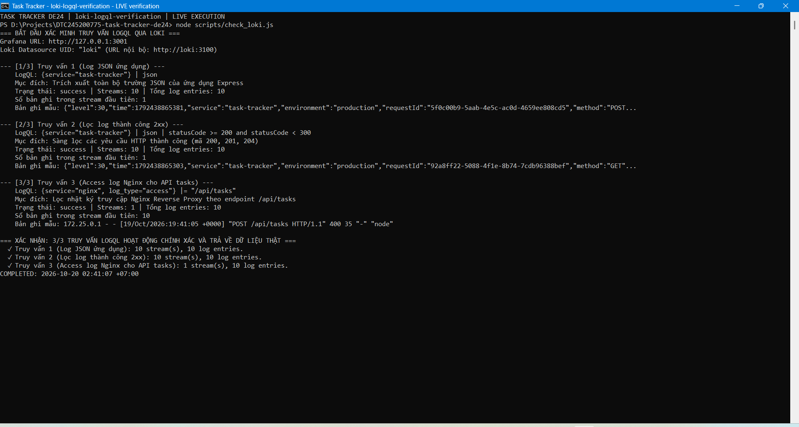
*Hình 7.2. Ảnh chụp cửa sổ PowerShell ghi nhận kết quả thực thi kiểm chứng 3 truy vấn LogQL thực tế trên terminal/API*

4. **Kết quả quan sát và ý nghĩa:**
- Truy vấn 1 (`{service="task-tracker"} | json`): Tìm thấy các streams log hoạt động, nạp thành công bản ghi log JSON từ `app.jsonl`.
- Truy vấn 2 (`{service="task-tracker"} | json | statusCode >= 200 and statusCode < 300`): Lọc thành công các bản ghi có mã trạng thái thành công thuộc dải 2xx (200, 201, 204), loại bỏ các mã lỗi. (Lưu ý kỹ thuật: Nếu chỉ dùng điều kiện `statusCode >= 200`, kết quả sẽ chứa cả các mã lỗi 4xx và 5xx; do đó điều kiện chặn trên `< 300` là cần thiết để phản ánh chính xác các request thành công).
- Truy vấn 3 (`{service="nginx", log_type="access"} |= "/api/tasks"`): Tìm thấy stream log Nginx chứa các dòng access log thực tế.
  * Phân biệt và đối chiếu request: Trong quy trình E2E, thao tác xóa task hợp lệ trả về `HTTP 204 No Content`. Dòng access log ghi nhận `DELETE /api/tasks/:id HTTP/1.1 404` xuất hiện sau đó là kết quả của một request dọn dẹp/xóa lại (cleanup check) để kiểm tra tính trơ (idempotency), chứng minh hệ thống từ chối chuẩn xác khi thao tác trên bản ghi đã bị xóa; đây là hai request hoàn toàn khác nhau, không phải cùng một request trả về hai kết quả mâu thuẫn.
  * Phân biệt lỗi kiểm thử và log runtime: Các lỗi kết nối database giả lập phát sinh trong bộ kiểm thử đơn vị (`npm test`) được tạo ra bởi mock in-memory trong tiến trình Node.js độc lập của test runner, tách biệt hoàn toàn với log vận hành runtime thực tế được Promtail ghi nhận và đẩy về Loki.
- Xác nhận 3/3 truy vấn LogQL đều đạt kết quả PASS thực tế trên dữ liệu hoạt động sống của hệ thống.

Dữ liệu đầu ra thô (raw terminal output) từ script kiểm chứng (được lưu tại `docs/logs/check_loki.log`):
```text
Captured live: 2026-10-20 02:41:07 +07:00
TASK TRACKER DE24 | loki-logql-verification | LIVE EXECUTION
PS D:\Projects\DTC245200775-task-tracker-de24> node scripts/check_loki.js
=== BẮT ĐẦU XÁC MINH TRUY VẤN LOGQL QUA LOKI ===
Grafana URL: http://127.0.0.1:3001
Loki Datasource UID: "loki" (URL nội bộ: http://loki:3100)

--- [1/3] Truy vấn 1 (Log JSON ứng dụng) ---
    LogQL: {service="task-tracker"} | json
    Mục đích: Trích xuất toàn bộ trường JSON của ứng dụng Express
    Trạng thái: success | Streams: 10 | Tổng log entries: 10
    Số bản ghi trong stream đầu tiên: 1
    Bản ghi mẫu: {"level":30,"time":1792438865381,"service":"task-tracker","environment":"production","requestId":"5f0c00b9-5aab-4e5c-ac0d-4659ee808cd5","method":"POST...

--- [2/3] Truy vấn 2 (Lọc log thành công 2xx) ---
    LogQL: {service="task-tracker"} | json | statusCode >= 200 and statusCode < 300
    Mục đích: Sàng lọc các yêu cầu HTTP thành công (mã 200, 201, 204)
    Trạng thái: success | Streams: 10 | Tổng log entries: 10
    Số bản ghi trong stream đầu tiên: 1
    Bản ghi mẫu: {"level":30,"time":1792438865303,"service":"task-tracker","environment":"production","requestId":"92a8ff22-5088-4f1e-8b74-7cdb96388bef","method":"GET"...

--- [3/3] Truy vấn 3 (Access log Nginx cho API tasks) ---
    LogQL: {service="nginx", log_type="access"} |= "/api/tasks"
    Mục đích: Lọc nhật ký truy cập Nginx Reverse Proxy theo endpoint /api/tasks
    Trạng thái: success | Streams: 1 | Tổng log entries: 10
    Số bản ghi trong stream đầu tiên: 10
    Bản ghi mẫu: 172.25.0.1 - - [19/Oct/2026:19:41:05 +0000] "POST /api/tasks HTTP/1.1" 400 35 "-" "node"

=== XÁC NHẬN: 3/3 TRUY VẤN LOGQL HOẠT ĐỘNG CHÍNH XÁC VÀ TRẢ VỀ DỮ LIỆU THẬT ===
  ✓ Truy vấn 1 (Log JSON ứng dụng): 10 stream(s), 10 log entries.
  ✓ Truy vấn 2 (Lọc log thành công 2xx): 10 stream(s), 10 log entries.
  ✓ Truy vấn 3 (Access log Nginx cho API tasks): 1 stream(s), 10 log entries.
COMPLETED: 2026-10-20 02:41:07 +07:00
```
5. **Cách tái hiện:** Chạy script `node scripts/check_loki.js` trong PowerShell.

## 7.6 Đánh giá vòng đời Promtail và định hướng Grafana Alloy

Theo thông báo chính thức từ Grafana Labs, Promtail đã chính thức bước vào giai đoạn End of Life (EOL) từ ngày 02/03/2026 và sẽ được thay thế hoàn toàn bởi **Grafana Alloy** (bộ thu thập dữ liệu thế hệ mới thống nhất cho cả metrics, logs, traces và profiles).

Việc đồ án này tiếp tục triển khai Promtail là nhằm đáp ứng chính xác tiêu chí kỹ thuật quy định trong rubric môn học của Đề tài 24. Trong môi trường doanh nghiệp tương lai, kiến trúc thu thập log này có thể dễ dàng chuyển đổi sang Grafana Alloy bằng cách cấu hình pipeline `loki.source.file` và `loki.write`, giữ nguyên hoàn toàn định dạng nhãn và các câu truy vấn LogQL đã xây dựng.

<!-- PAGEBREAK -->

# CHƯƠNG 8. HARDENING, KIỂM THỬ TOÀN DIỆN VÀ ĐÁNH GIÁ AN TOÀN

## 8.1 Nguyên tắc đặc quyền tối thiểu và bảo vệ Container

Bảo vệ an toàn cho hệ thống container đòi hỏi việc triển khai nhiều lớp phòng thủ theo chiều sâu (Defense-in-Depth). Hệ thống Task Tracker áp dụng nghiêm ngặt các biện pháp tăng cường bảo mật cốt lõi:
1. **Tiến trình Non-Root:**
   - Ứng dụng Node.js chạy dưới tài khoản người dùng `node` có định danh số tường minh: `UID 10001, GID 10001`.
   - Nginx chạy dưới tài khoản người dùng unprivileged: `UID 101, GID 101`.
   - Đối với dịch vụ khởi tạo `log-init`, container chạy quyền root (`user: "0:0"`) một lần duy nhất lúc khởi động để thực hiện phân quyền sở hữu thư mục volume (`chown 10001:10001 /logs/app` và `chown 101:101 /logs/nginx`), sau đó kết thúc ngay với mã thoát `0` (`restart: "no"`).
   - Ngay cả khi kẻ tấn công tìm được lỗ hổng thực thi mã từ xa (RCE) trong ứng dụng hoặc proxy, quyền hạn chiếm được cũng chỉ là một người dùng thông thường, không thể can thiệp vào kernel hay kiểm soát máy chủ vật lý host.
2. **Hệ thống tệp gốc chỉ đọc (`read_only: true`):**
   - Hai container tiếp nhận xử lý ứng dụng và tầng biên là `task-app` và `nginx` đều được kích hoạt cờ `read_only: true`. Kẻ tấn công không thể ghi đè mã nguồn, cài đặt backdoor hay tải các công cụ khai thác nhị phân vào container filesystem.
   - Các vùng nhớ tạm thời cần thiết được gắn qua bộ nhớ ảo `tmpfs` giới hạn kích thước 16MB kèm cờ bảo vệ chống thực thi: `/tmp:rw,noexec,nosuid,size=16m`.
   - Các container cơ sở dữ liệu (`db`) và giám sát (`prometheus`, `loki`, `grafana`) cần duy trì trạng thái ghi dữ liệu vào các named volume chuyên dụng tương ứng, do đó không áp dụng cờ read-only rootfs.
3. **Thu hồi Linux Capabilities (`cap_drop: [ALL]`):**
   - Áp dụng trên `task-app` và `nginx` để loại bỏ toàn bộ các đặc quyền nhân Linux mặc định. Container không thể can thiệp mạng, không thể mount filesystem và không thể thay đổi quyền sở hữu tệp.
4. **Ngăn chặn nâng đặc quyền (`no-new-privileges: true`):**
   - Kích hoạt tùy chọn bảo mật `no-new-privileges: true` cho toàn bộ các dịch vụ vận hành chính (`db`, `task-app`, `nginx`, `postgres-exporter`, `nginx-exporter`, `cadvisor`, `prometheus`, `loki`, `promtail`, `grafana`), ngăn chặn triệt để các tiến trình con chiếm quyền quản trị thông qua các tệp có cờ `setuid` hoặc `setgid`.

## 8.2 Cô lập mạng và phân quyền Role Database

- **Cô lập mạng chuyên trách:** Như đã quy hoạch tại Chương 3, hệ thống tách biệt rõ ràng các phân vùng mạng:
  * Hai mạng `data` và `observability` được cấu hình cờ `internal: true`. Docker không cấp gateway ra ngoài cho hai mạng này. Các dịch vụ chỉ tham gia mạng nội bộ (như PostgreSQL `db`, máy chủ `loki`, `promtail`, `cadvisor`) hoàn toàn không có đường định tuyến ra ngoài Internet, ngăn ngừa việc bị dò quét cổng hoặc tấn công trực tiếp.
  * Hai mạng `front` và `management` là mạng bridge thông thường không có cờ internal. Các container đa mạng (multi-homed) như `task-app` (nối cả `front`, `data`, `observability`) hoặc `grafana`, `prometheus`, `pgadmin` (nối `management`) sở hữu giao diện mạng bridge và vẫn có khả năng định tuyến ra ngoài khi cần thiết qua interface non-internal tương ứng.
- **Che giấu cổng dịch vụ:** Các cổng `3000` (Node.js) và `5432` (PostgreSQL) hoàn toàn không được map ra cổng host. Mọi truy cập dữ liệu nghiệp vụ bắt buộc phải đi qua Nginx hoặc pgAdmin.
- **Phân quyền Role PostgreSQL:** Cả hai role `task_app` và `metrics_exporter` đều có cờ `rolsuper = false`. Trong đó, `task_app` được cấp quyền `CONNECT ON DATABASE task_tracker` cùng quyền `USAGE, CREATE ON SCHEMA public` (`db/init/01-create-roles.sh`) nhằm phục vụ cơ chế tự động chạy migration DDL (`001_tasks.sql`) khởi tạo bảng `tasks` và chỉ mục khi ứng dụng khởi động, đồng thời thực hiện các thao tác DML (CRUD) trên dữ liệu công việc mà không sở hữu quyền superuser hay khả năng can thiệp vào các cấu hình quản trị hệ thống. Role `metrics_exporter` chỉ được cấp quyền `CONNECT` và membership `pg_monitor` để phục vụ trích xuất số liệu giám sát.

## 8.3 Ma trận kiểm thử toàn diện hệ thống

Bảng 8.1 tổng hợp kết quả thực thi 10 ca kiểm thử nghiệm thu toàn diện được tiến hành trực tiếp trên hệ thống:

| Mã ca | Mục tiêu và thao tác kiểm tra | Kết quả mong đợi chuẩn | Kết quả thực nghiệm thực tế | Trạng thái |
|---|---|---|---|---|
| **T01** | Tạo task hợp lệ qua `POST /api/tasks` | HTTP 201 Created, trả về JSON task có ID tự tăng, lưu bền vững vào DB | HTTP 201 Created, task ID tự tăng lưu thành công vào PostgreSQL | **ĐẠT (PASS)** |
| **T02** | Gửi dữ liệu sai: tiêu đề rỗng, ngày sai, status/priority sai quy định | HTTP 400 Bad Request, trả về mảng thông báo lỗi, không ghi dữ liệu | HTTP 400 Bad Request, thông báo lỗi xác thực rõ ràng | **ĐẠT (PASS)** |
| **T03** | Gửi JSON cú pháp hỏng (Malformed JSON) tới API | HTTP 400 Bad Request, ứng dụng bắt lỗi an toàn, không rò rỉ stack trace | HTTP 400 Bad Request, bắt lỗi JSON parser an toàn | **ĐẠT (PASS)** |
| **T04** | Cập nhật task qua `PATCH /api/tasks/:id` | HTTP 200 OK, các trường gửi lên được cập nhật, `updated_at` đổi mới | HTTP 200 OK, trường `status` chuyển thành `"in_progress"` | **ĐẠT (PASS)** |
| **T05** | Xóa task qua `DELETE /api/tasks/:id` và kiểm tra lại | Xóa trả về HTTP 204 No Content; thao tác PATCH/DELETE sau đó trả về HTTP 404 | HTTP 204 khi xóa; PATCH task đã xóa trả về HTTP 404 Not Found | **ĐẠT (PASS)** |
| **T06** | Kiểm tra 5 HTTP Security Headers của Nginx qua cURL | Đầy đủ 5 tiêu đề: CSP, X-Frame-Options, X-Content-Type-Options, Referrer, Permissions | Đầy đủ 5 headers chính xác 100% tại cổng 8080 | **ĐẠT (PASS)** |
| **T07** | Kiểm tra trạng thái Prometheus Targets API | 5/5 targets đạt trạng thái `UP` (100% healthy) | 5/5 targets UP: app, postgres, nginx, cadvisor, prometheus | **ĐẠT (PASS)** |
| **T08** | Kiểm tra hiển thị Grafana Dashboard và Loki LogQL | Dashboard nạp metrics thời gian thực; 3 câu LogQL trích xuất đúng log | Dashboard nạp đủ số liệu; 3 truy vấn LogQL trả về log thực tế | **ĐẠT (PASS)** |
| **T09** | Xác minh hardening: Non-root UID, ReadOnlyRootfs, CapDrop | App chạy UID 10001, Nginx UID 101, ReadOnlyRootfs=true, CapDrop ALL | Xác nhận đúng cấu hình an toàn trên container đang chạy | **ĐẠT (PASS)** |
| **T10** | Kiểm tra tính bền vững (Persistence) sau `docker compose restart` | Dữ liệu marker task còn nguyên vẹn trong volume sau khi restart container | Marker task tồn tại nguyên vẹn sau restart `db` và `task-app` | **ĐẠT (PASS)** |

*Bảng 8.1. Ma trận kiểm thử hệ thống và trạng thái nghiệm thu thực tế*

## 8.4 Kiểm thử tự động ứng dụng (Unit & Integration Tests)

1. **Mục tiêu:** Chạy bộ kiểm thử tự động của ứng dụng Node.js Express sử dụng test runner tích hợp sẵn (`node --test`), kiểm tra toàn bộ logic xác thực nghiệp vụ và xử lý lỗi cơ sở dữ liệu giả lập.
2. **Lệnh thực hiện:**
```powershell
cd app
npm test
```
3. **Ảnh minh chứng:**

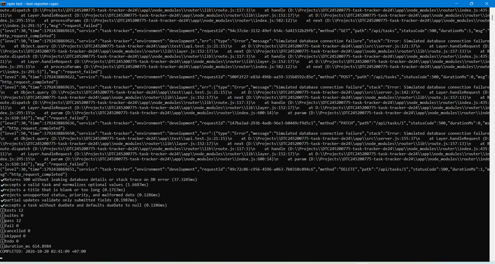
*Hình 8.1. Ảnh chụp cửa sổ PowerShell ghi nhận kết quả thực thi bộ kiểm thử ứng dụng tự động (npm test, 12/12 test pass) trên terminal*

4. **Kết quả quan sát và ý nghĩa:**
Toàn bộ 12 ca kiểm thử (bao gồm kiểm tra validation tiêu đề, độ dài, ngày tháng, trạng thái, mức ưu tiên, partial update, xử lý lỗi 404 và xử lý lỗi kết nối DB trả về 500 an toàn không lộ stack trace) đều đạt kết quả `pass 12`, không có ca kiểm thử nào thất bại (`fail 0`).
Lưu ý: Ca kiểm thử "Returns 500 without leaking database details or stack trace on DB error" và "GET /health returns 503 when database fails" sử dụng kỹ thuật mock lỗi in-memory độc lập trong bộ nhớ của tiến trình test runner (`node --test`), hoàn toàn tách biệt với database PostgreSQL sống và log runtime trên Loki.

Dữ liệu đầu ra thô (raw terminal output) trích xuất trực tiếp từ file nhật ký kiểm thử `docs/logs/unit_tests.log`:
```text
Captured live: 2026-10-20 02:41:08 +07:00
TASK TRACKER DE24 | unit-api-tests | LIVE EXECUTION
PS D:\Projects\DTC245200775-task-tracker-de24> npm --prefix app test -- --test-reporter=spec

> task-tracker-de24@1.0.0 test
> node --test --test-reporter=spec

{"level":30,"time":1792438869330,"service":"task-tracker","environment":"development","requestId":"1b37f439-e35f-4043-9eab-beb14c459683","method":"GET","path":"/health","statusCode":200,"durationMs":3,"msg":"http_request_completed"}
✔ GET /health returns 200 and ok when database is healthy (40.2118ms)
{"level":50,"time":1792438869344,"service":"task-tracker","environment":"development","err":{"type":"Error","message":"Simulated database connection failure","stack":"Error: Simulated database connection failure\n    at Object.query (D:\\Projects\\DTC245200775-task-tracker-de24\\app\\test\\api.test.js:21:15)\n    at D:\\Projects\\DTC245200775-task-tracker-de24\\app\\src\\server.js:90:22\n    at Layer.handleRequest (D:\\Projects\\DTC245200775-task-tracker-de24\\app\\node_modules\\router\\lib\\layer.js:152:17)\n    at next (D:\\Projects\\DTC245200775-task-tracker-de24\\app\\node_modules\\router\\lib\\route.js:157:13)\n    at Route.dispatch (D:\\Projects\\DTC245200775-task-tracker-de24\\app\\node_modules\\router\\lib\\route.js:117:3)\n    at handle (D:\\Projects\\DTC245200775-task-tracker-de24\\app\\node_modules\\router\\index.js:435:11)\n    at Layer.handleRequest (D:\\Projects\\DTC245200775-task-tracker-de24\\app\\node_modules\\router\\lib\\layer.js:152:17)\n    at D:\\Projects\\DTC245200775-task-tracker-de24\\app\\node_modules\\router\\index.js:295:15\n    at processParams (D:\\Projects\\DTC245200775-task-tracker-de24\\app\\node_modules\\router\\index.js:582:12)\n    at next (D:\\Projects\\DTC245200775-task-tracker-de24\\app\\node_modules\\router\\index.js:291:5)"},"msg":"health_check_failed"}
{"level":30,"time":1792438869345,"service":"task-tracker","environment":"development","requestId":"cd3b79e5-78a2-4d35-9ae8-f26ed2f774de","method":"GET","path":"/health","statusCode":503,"durationMs":1,"msg":"http_request_completed"}
✔ GET /health returns 503 when database fails (8.9699ms)
{"level":30,"time":1792438869352,"service":"task-tracker","environment":"development","requestId":"65908cc9-803e-4d84-b50c-f6dec24dd2f3","method":"GET","path":"/metrics","statusCode":200,"durationMs":2,"msg":"http_request_completed"}
✔ GET /metrics returns 200 with Prometheus text metrics (7.4193ms)
{"level":30,"time":1792438869358,"service":"task-tracker","environment":"development","requestId":"17a832d9-29ff-4c47-9f2a-6453c76d26fe","method":"GET","path":"/api/tasks","statusCode":200,"durationMs":1,"msg":"http_request_completed"}
{"level":30,"time":1792438869371,"service":"task-tracker","environment":"development","requestId":"b3c28b7c-f44d-451c-ae0e-13929807d34d","method":"POST","path":"/api/tasks","statusCode":201,"durationMs":1,"msg":"http_request_completed"}
{"level":30,"time":1792438869383,"service":"task-tracker","environment":"development","requestId":"8891020d-c1cd-4755-ad58-b430f28bbdb7","method":"POST","path":"/api/tasks","statusCode":201,"durationMs":0,"msg":"http_request_completed"}
{"level":30,"time":1792438869386,"service":"task-tracker","environment":"development","requestId":"e18754e0-1a38-449a-a49f-bb92834df607","method":"GET","path":"/api/tasks","statusCode":200,"durationMs":0,"msg":"http_request_completed"}
{"level":30,"time":1792438869402,"service":"task-tracker","environment":"development","requestId":"fae7bc22-b8cc-4cc7-8c2e-4a3d85a26849","method":"GET","path":"/api/tasks","statusCode":200,"durationMs":1,"msg":"http_request_completed"}
{"level":30,"time":1792438869418,"service":"task-tracker","environment":"development","requestId":"c912886c-c9bd-4b2d-9444-67164fe3bfc6","method":"GET","path":"/api/tasks","statusCode":200,"durationMs":1,"msg":"http_request_completed"}
{"level":30,"time":1792438869435,"service":"task-tracker","environment":"development","requestId":"eee39ae3-5a08-4ffe-98c8-c8fbb27da76d","method":"PATCH","path":"/api/tasks/1","statusCode":200,"durationMs":1,"msg":"http_request_completed"}
{"level":30,"time":1792438869450,"service":"task-tracker","environment":"development","requestId":"81270258-001a-4a35-bc90-4d5a898b5af7","method":"DELETE","path":"/api/tasks/1","statusCode":204,"durationMs":1,"msg":"http_request_completed"}
{"level":30,"time":1792438869465,"service":"task-tracker","environment":"development","requestId":"70aa6eb5-c9b8-472b-83e6-d3e3648c32ed","method":"GET","path":"/api/tasks","statusCode":200,"durationMs":1,"msg":"http_request_completed"}
✔ Full CRUD flow: create, read, filter, search, update, delete (113.1517ms)
{"level":30,"time":1792438869473,"service":"task-tracker","environment":"development","requestId":"b36a66a9-e309-4b17-8b83-8968f9d967f4","method":"POST","path":"/api/tasks","statusCode":400,"durationMs":0,"msg":"http_request_completed"}
{"level":30,"time":1792438869475,"service":"task-tracker","environment":"development","requestId":"34beaaf1-01bf-432f-8b62-9b87d5b13816","method":"POST","path":"/api/tasks","statusCode":400,"durationMs":0,"msg":"http_request_completed"}
{"level":30,"time":1792438869481,"service":"task-tracker","environment":"development","requestId":"a5e2a528-5b85-4b38-98c2-488f3270f0b3","method":"POST","path":"/api/tasks","statusCode":400,"durationMs":0,"msg":"http_request_completed"}
{"level":30,"time":1792438869497,"service":"task-tracker","environment":"development","requestId":"caed8933-18c5-42b7-b167-bd68163827f5","method":"POST","path":"/api/tasks","statusCode":400,"durationMs":1,"msg":"http_request_completed"}
{"level":30,"time":1792438869514,"service":"task-tracker","environment":"development","requestId":"9c9d8b78-3ea3-4719-a015-43b7d75c7fcb","method":"POST","path":"/api/tasks","statusCode":400,"durationMs":0,"msg":"http_request_completed"}
{"level":30,"time":1792438869529,"service":"task-tracker","environment":"development","requestId":"753798c0-5b41-416d-a6b5-1563b0f1b722","method":"POST","path":"/api/tasks","statusCode":400,"durationMs":0,"msg":"http_request_completed"}
{"level":30,"time":1792438869543,"service":"task-tracker","environment":"development","requestId":"8781cb88-d110-4465-9029-0f8097370801","method":"GET","path":"/api/tasks","statusCode":400,"durationMs":0,"msg":"http_request_completed"}
{"level":30,"time":1792438869559,"service":"task-tracker","environment":"development","requestId":"d00ba930-1b60-41f4-a955-bfb20da89aea","method":"PATCH","path":"/api/tasks/not-an-id","statusCode":400,"durationMs":0,"msg":"http_request_completed"}
{"level":30,"time":1792438869574,"service":"task-tracker","environment":"development","requestId":"ba82709c-74b6-49f5-aa33-22a4eef74467","method":"PATCH","path":"/api/tasks/1","statusCode":400,"durationMs":0,"msg":"http_request_completed"}
{"level":30,"time":1792438869589,"service":"task-tracker","environment":"development","requestId":"36fde5e7-28bb-4b65-97cc-d1846f429acb","method":"DELETE","path":"/api/tasks/abc","statusCode":400,"durationMs":0,"msg":"http_request_completed"}
{"level":50,"time":1792438869606,"service":"task-tracker","environment":"development","err":{"type":"SyntaxError","message":"Expected property name or '}' in JSON at position 2 (line 1 column 3)","stack":"SyntaxError: Expected property name or '}' in JSON at position 2 (line 1 column 3)\n    at JSON.parse (<anonymous>)\n    at parse (D:\\Projects\\DTC245200775-task-tracker-de24\\app\\node_modules\\body-parser\\lib\\types\\json.js:91:21)\n    at D:\\Projects\\DTC245200775-task-tracker-de24\\app\\node_modules\\body-parser\\lib\\read.js:162:18\n    at AsyncResource.runInAsyncScope (node:async_hooks:227:14)\n    at invokeCallback (D:\\Projects\\DTC245200775-task-tracker-de24\\app\\node_modules\\raw-body\\index.js:238:16)\n    at done (D:\\Projects\\DTC245200775-task-tracker-de24\\app\\node_modules\\raw-body\\index.js:227:7)\n    at IncomingMessage.onEnd (D:\\Projects\\DTC245200775-task-tracker-de24\\app\\node_modules\\raw-body\\index.js:287:7)\n    at IncomingMessage.emit (node:events:514:28)\n    at endReadableNT (node:internal/streams/readable:1757:12)\n    at process.processTicksAndRejections (node:internal/process/task_queues:90:21)","expose":true,"statusCode":400,"status":400,"body":"{ broken json"},"msg":"request_failed"}
✔ Input validation rejects invalid requests with 400 (139.9659ms)
{"level":30,"time":1792438869611,"service":"task-tracker","environment":"development","requestId":"28cb13ac-edcb-4f3e-aee2-c6cb50837eca","method":"PATCH","path":"/api/tasks/999","statusCode":404,"durationMs":0,"msg":"http_request_completed"}
{"level":30,"time":1792438869614,"service":"task-tracker","environment":"development","requestId":"9216bd83-3c43-4068-a695-48e0944c4baa","method":"DELETE","path":"/api/tasks/999","statusCode":404,"durationMs":0,"msg":"http_request_completed"}
✔ Returns 404 when updating or deleting a nonexistent task (7.702ms)
{"level":50,"time":1792438869619,"service":"task-tracker","environment":"development","err":{"type":"Error","message":"Simulated database connection failure","stack":"Error: Simulated database connection failure\n    at Object.query (D:\\Projects\\DTC245200775-task-tracker-de24\\app\\test\\api.test.js:21:15)\n    at D:\\Projects\\DTC245200775-task-tracker-de24\\app\\src\\server.js:112:37\n    at Layer.handleRequest (D:\\Projects\\DTC245200775-task-tracker-de24\\app\\node_modules\\router\\lib\\layer.js:152:17)\n    at next (D:\\Projects\\DTC245200775-task-tracker-de24\\app\\node_modules\\router\\lib\\route.js:157:13)\n    at Route.dispatch (D:\\Projects\\DTC245200775-task-tracker-de24\\app\\node_modules\\router\\lib\\route.js:117:3)\n    at handle (D:\\Projects\\DTC245200775-task-tracker-de24\\app\\node_modules\\router\\index.js:435:11)\n    at Layer.handleRequest (D:\\Projects\\DTC245200775-task-tracker-de24\\app\\node_modules\\router\\lib\\layer.js:152:17)\n    at D:\\Projects\\DTC245200775-task-tracker-de24\\app\\node_modules\\router\\index.js:295:15\n    at processParams (D:\\Projects\\DTC245200775-task-tracker-de24\\app\\node_modules\\router\\index.js:582:12)\n    at next (D:\\Projects\\DTC245200775-task-tracker-de24\\app\\node_modules\\router\\index.js:291:5)"},"msg":"request_failed"}
{"level":30,"time":1792438869619,"service":"task-tracker","environment":"development","requestId":"94c37c6e-3132-49ef-b54c-5d41532b29fb","method":"GET","path":"/api/tasks","statusCode":500,"durationMs":1,"msg":"http_request_completed"}
{"level":50,"time":1792438869621,"service":"task-tracker","environment":"development","err":{"type":"Error","message":"Simulated database connection failure","stack":"Error: Simulated database connection failure\n    at Object.query (D:\\Projects\\DTC245200775-task-tracker-de24\\app\\test\\api.test.js:21:15)\n    at D:\\Projects\\DTC245200775-task-tracker-de24\\app\\src\\server.js:121:37\n    at Layer.handleRequest (D:\\Projects\\DTC245200775-task-tracker-de24\\app\\node_modules\\router\\lib\\layer.js:152:17)\n    at next (D:\\Projects\\DTC245200775-task-tracker-de24\\app\\node_modules\\router\\lib\\route.js:157:13)\n    at Route.dispatch (D:\\Projects\\DTC245200775-task-tracker-de24\\app\\node_modules\\router\\lib\\route.js:117:3)\n    at handle (D:\\Projects\\DTC245200775-task-tracker-de24\\app\\node_modules\\router\\index.js:435:11)\n    at Layer.handleRequest (D:\\Projects\\DTC245200775-task-tracker-de24\\app\\node_modules\\router\\lib\\layer.js:152:17)\n    at D:\\Projects\\DTC245200775-task-tracker-de24\\app\\node_modules\\router\\index.js:295:15\n    at processParams (D:\\Projects\\DTC245200775-task-tracker-de24\\app\\node_modules\\router\\index.js:582:12)\n    at next (D:\\Projects\\DTC245200775-task-tracker-de24\\app\\node_modules\\router\\index.js:291:5)"},"msg":"request_failed"}
{"level":30,"time":1792438869622,"service":"task-tracker","environment":"development","requestId":"500f2f27-e83d-496b-aa59-335b8592c85e","method":"POST","path":"/api/tasks","statusCode":500,"durationMs":0,"msg":"http_request_completed"}
{"level":50,"time":1792438869635,"service":"task-tracker","environment":"development","err":{"type":"Error","message":"Simulated database connection failure","stack":"Error: Simulated database connection failure\n    at Object.query (D:\\Projects\\DTC245200775-task-tracker-de24\\app\\test\\api.test.js:21:15)\n    at D:\\Projects\\DTC245200775-task-tracker-de24\\app\\src\\server.js:142:37\n    at Layer.handleRequest (D:\\Projects\\DTC245200775-task-tracker-de24\\app\\node_modules\\router\\lib\\layer.js:152:17)\n    at next (D:\\Projects\\DTC245200775-task-tracker-de24\\app\\node_modules\\router\\lib\\route.js:157:13)\n    at Route.dispatch (D:\\Projects\\DTC245200775-task-tracker-de24\\app\\node_modules\\router\\lib\\route.js:117:3)\n    at handle (D:\\Projects\\DTC245200775-task-tracker-de24\\app\\node_modules\\router\\index.js:435:11)\n    at Layer.handleRequest (D:\\Projects\\DTC245200775-task-tracker-de24\\app\\node_modules\\router\\lib\\layer.js:152:17)\n    at D:\\Projects\\DTC245200775-task-tracker-de24\\app\\node_modules\\router\\index.js:295:15\n    at param (D:\\Projects\\DTC245200775-task-tracker-de24\\app\\node_modules\\router\\index.js:600:14)\n    at param (D:\\Projects\\DTC245200775-task-tracker-de24\\app\\node_modules\\router\\index.js:610:14)"},"msg":"request_failed"}
{"level":30,"time":1792438869636,"service":"task-tracker","environment":"development","requestId":"147ba3ad-293b-4adb-96e3-b0449cf9d5c1","method":"PATCH","path":"/api/tasks/1","statusCode":500,"durationMs":0,"msg":"http_request_completed"}
{"level":50,"time":1792438869650,"service":"task-tracker","environment":"development","err":{"type":"Error","message":"Simulated database connection failure","stack":"Error: Simulated database connection failure\n    at Object.query (D:\\Projects\\DTC245200775-task-tracker-de24\\app\\test\\api.test.js:21:15)\n    at D:\\Projects\\DTC245200775-task-tracker-de24\\app\\src\\server.js:155:37\n    at Layer.handleRequest (D:\\Projects\\DTC245200775-task-tracker-de24\\app\\node_modules\\router\\lib\\layer.js:152:17)\n    at next (D:\\Projects\\DTC245200775-task-tracker-de24\\app\\node_modules\\router\\lib\\route.js:157:13)\n    at Route.dispatch (D:\\Projects\\DTC245200775-task-tracker-de24\\app\\node_modules\\router\\lib\\route.js:117:3)\n    at handle (D:\\Projects\\DTC245200775-task-tracker-de24\\app\\node_modules\\router\\index.js:435:11)\n    at Layer.handleRequest (D:\\Projects\\DTC245200775-task-tracker-de24\\app\\node_modules\\router\\lib\\layer.js:152:17)\n    at D:\\Projects\\DTC245200775-task-tracker-de24\\app\\node_modules\\router\\index.js:295:15\n    at param (D:\\Projects\\DTC245200775-task-tracker-de24\\app\\node_modules\\router\\index.js:600:14)\n    at param (D:\\Projects\\DTC245200775-task-tracker-de24\\app\\node_modules\\router\\index.js:610:14)"},"msg":"request_failed"}
{"level":30,"time":1792438869651,"service":"task-tracker","environment":"development","requestId":"49c72c06-c956-4596-a063-7b0310c094c6","method":"DELETE","path":"/api/tasks/1","statusCode":500,"durationMs":1,"msg":"http_request_completed"}
✔ Returns 500 without leaking database details or stack trace on DB error (37.3245ms)
✔ accepts a valid task and normalizes optional values (1.6687ms)
✔ rejects a title that is blank or too long (0.1717ms)
✔ rejects unsupported status, priority, and malformed date (0.1286ms)
✔ partial updates validate only submitted fields (0.1987ms)
✔ accepts a task without dueDate and defaults dueDate to null (0.1106ms)
ℹ tests 12
ℹ suites 0
ℹ pass 12
ℹ fail 0
ℹ cancelled 0
ℹ skipped 0
ℹ todo 0
ℹ duration_ms 614.8984
COMPLETED: 2026-10-20 02:41:09 +07:00
```
5. **Cách tái hiện:** Chuyển vào thư mục `app`, chạy lệnh `npm test` và đối chiếu với file nhật ký `docs/logs/unit_tests.log`.

## 8.5 Xác minh thực nghiệm cơ chế Hardening

1. **Mục tiêu:** Kiểm tra định danh người dùng (UID/GID) bên trong container và rà soát cấu hình an toàn HostConfig qua Docker API.
2. **Lệnh thực hiện:**
```powershell
docker compose exec task-app id
docker compose exec nginx id
docker inspect -f "ReadOnlyRootfs: {{.HostConfig.ReadonlyRootfs}}, CapDrop: {{.HostConfig.CapDrop}}, SecurityOpt: {{.HostConfig.SecurityOpt}}" task-tracker-de24-task-app-1
```
3. **Ảnh minh chứng:**

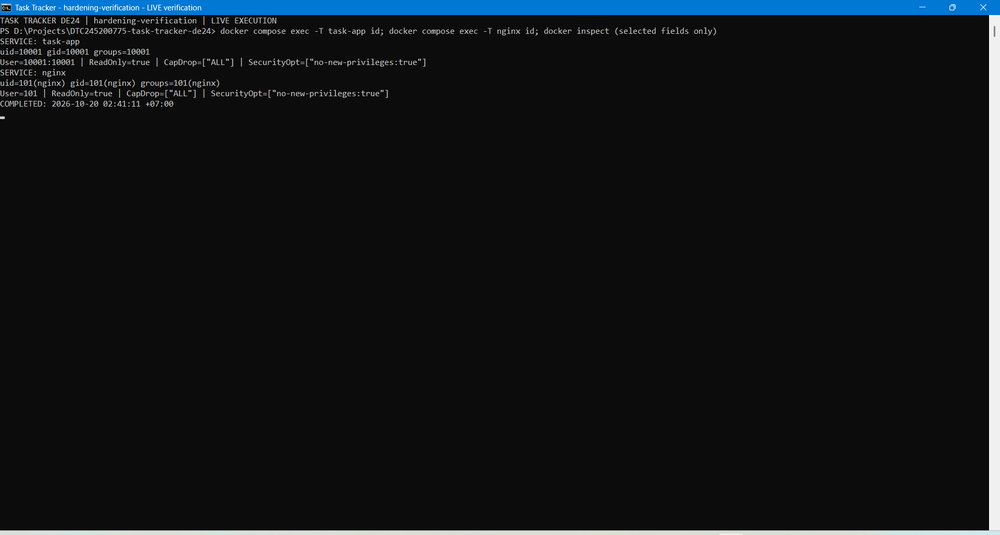
*Hình 8.2. Ảnh chụp cửa sổ PowerShell ghi nhận kết quả xác minh thực nghiệm đặc quyền non-root (UID 10001, 101), ReadOnlyRootfs và drop capabilities trên terminal*

4. **Kết quả quan sát và ý nghĩa:**
- `task-app` chạy với `uid=10001 gid=10001`.
- `nginx` chạy với `uid=101(nginx) gid=101(nginx)`.
- `ReadOnlyRootfs: true`, `CapDrop: [ALL]`, `SecurityOpt: [no-new-privileges:true]`.
Khẳng định chính sách gia cố an ninh đã được áp dụng chuẩn xác trên các container tiếp nhận xử lý dữ liệu.

Dữ liệu đầu ra thô (raw terminal output) trích xuất từ phiên kiểm tra (được lưu tại `docs/logs/hardening.log`):
```text
Captured live: 2026-10-20 02:41:10 +07:00
TASK TRACKER DE24 | hardening-verification | LIVE EXECUTION
PS D:\Projects\DTC245200775-task-tracker-de24> docker compose exec -T task-app id; docker compose exec -T nginx id; docker inspect (selected fields only)
SERVICE: task-app
uid=10001 gid=10001 groups=10001
User=10001:10001 | ReadOnly=true | CapDrop=["ALL"] | SecurityOpt=["no-new-privileges:true"]
SERVICE: nginx
uid=101(nginx) gid=101(nginx) groups=101(nginx)
User=101 | ReadOnly=true | CapDrop=["ALL"] | SecurityOpt=["no-new-privileges:true"]
COMPLETED: 2026-10-20 02:41:11 +07:00
```
5. **Cách tái hiện:** Thực thi các lệnh kiểm tra trên trong PowerShell khi container đang chạy.

## 8.6 Xác minh cô lập mạng, Role Database và Port Isolation

1. **Mục tiêu:** Chứng minh các phân vùng mạng nội bộ có cờ `Internal=true`, các role PostgreSQL không có quyền superuser và các cổng dịch vụ nội bộ không bị hở ra ngoài máy host.
2. **Lệnh thực hiện:**
```powershell
docker network inspect task-tracker-de24_data task-tracker-de24_observability -f '{{.Name}}: Internal={{.Internal}}'
docker compose exec -T db psql -U postgres -d task_tracker -c "SELECT rolname, rolsuper, rolcanlogin FROM pg_roles WHERE rolname IN ('task_app', 'metrics_exporter', 'postgres');"
docker ps --filter "name=task-tracker-de24" --format "table {{.Names}}\t{{.Ports}}"
```
3. **Ảnh minh chứng:**

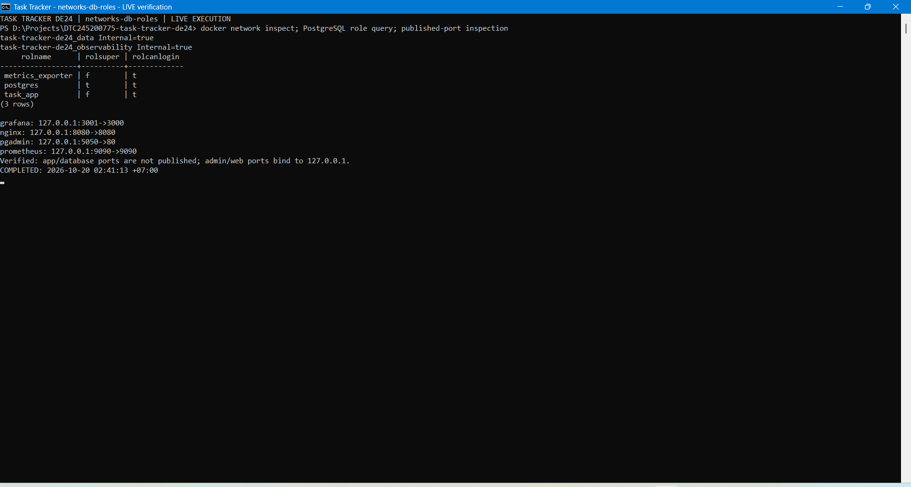
*Hình 8.3. Ảnh chụp cửa sổ PowerShell ghi nhận kết quả kiểm tra phân tách mạng Docker (Internal=true), DB least privilege và cách ly port bindings trên terminal*

4. **Kết quả quan sát và ý nghĩa:**
- Cả hai mạng `task-tracker-de24_data` và `task-tracker-de24_observability` đều có `Internal: true`.
- Role `task_app` và `metrics_exporter` đều có `rolsuper: f` (False — không phải superuser).
- Cổng `3000` (app) và `5432` (db) hoàn toàn không có port mapping ra host; các cổng quản trị đều chỉ bind loopback `127.0.0.1`.

Dữ liệu đầu ra thô (raw terminal output) trích xuất từ phiên kiểm tra (được lưu tại `docs/logs/networks_roles.log`):
```text
Captured live: 2026-10-20 02:41:12 +07:00
TASK TRACKER DE24 | networks-db-roles | LIVE EXECUTION
PS D:\Projects\DTC245200775-task-tracker-de24> docker network inspect; PostgreSQL role query; published-port inspection
task-tracker-de24_data Internal=true
task-tracker-de24_observability Internal=true
     rolname      | rolsuper | rolcanlogin
------------------+----------+-------------
 metrics_exporter | f        | t
 postgres         | t        | t
 task_app         | f        | t
(3 rows)

grafana: 127.0.0.1:3001->3000
nginx: 127.0.0.1:8080->8080
pgadmin: 127.0.0.1:5050->80
prometheus: 127.0.0.1:9090->9090
Verified: app/database ports are not published; admin/web ports bind to 127.0.0.1.
COMPLETED: 2026-10-20 02:41:13 +07:00
```
5. **Cách tái hiện:** Thực thi các lệnh Docker inspect và PSQL query trong PowerShell.

## 8.7 Kiểm thử tính bền vững của dữ liệu và lịch sử Git

1. **Mục tiêu:** Chứng minh dữ liệu trong cơ sở dữ liệu PostgreSQL được lưu trữ bền vững (Data Persistence) qua chu kỳ khởi động lại container (không mất dữ liệu khi restart dịch vụ) và kiểm tra lịch sử commit dự án.
2. **Thao tác:**
   - Tạo một marker task kiểm thử mang tên `PERSISTENCE-MARKER-...` qua API.
   - Khởi động lại hai container cốt lõi: `docker compose restart db task-app` (tuyệt đối không xóa volume).
   - Truy vấn lại API và xác nhận marker task vẫn tồn tại nguyên vẹn.
   - Dọn dẹp marker task và kiểm tra `git log`.
3. **Ảnh minh chứng:**

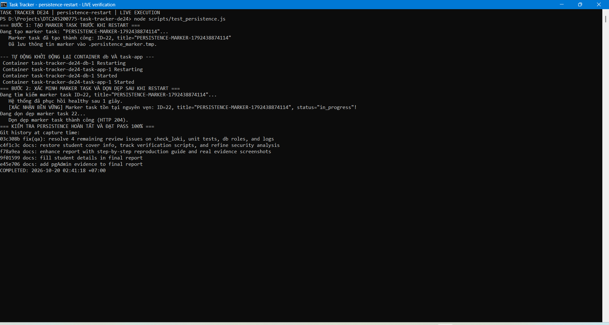
*Hình 8.4. Ảnh chụp cửa sổ PowerShell ghi nhận kết quả kiểm tra tính bền vững dữ liệu (Persistence) qua marker task và lịch sử commit Git trên terminal*

4. **Kết quả quan sát và ý nghĩa:**
Sau khi `db` và `task-app` khởi động lại, dịch vụ nhanh chóng trở lại trạng thái healthy; truy vấn API tìm thấy chính xác marker task với đầy đủ tiêu đề và trạng thái. Volume Docker `postgres_data` đã bảo vệ dữ liệu độc lập hoàn toàn với vòng đời của container. Lịch sử commit Git thể hiện các bước phát triển tuần tự, rõ ràng và có cấu trúc.

Dữ liệu đầu ra thô (raw terminal output) trích xuất từ phiên kiểm tra (được lưu tại `docs/logs/test_persistence.log`):
```text
Captured live: 2026-10-20 02:41:14 +07:00
TASK TRACKER DE24 | persistence-restart | LIVE EXECUTION
PS D:\Projects\DTC245200775-task-tracker-de24> node scripts/test_persistence.js
=== BƯỚC 1: TẠO MARKER TASK TRƯỚC KHI RESTART ===
Đang tạo marker task: "PERSISTENCE-MARKER-1792438874114"...
   Marker task đã tạo thành công: ID=22, title="PERSISTENCE-MARKER-1792438874114"
   Đã lưu thông tin marker vào .persistence_marker.tmp.

--- TỰ ĐỘNG KHỞI ĐỘNG LẠI CONTAINER db VÀ task-app ---
 Container task-tracker-de24-db-1 Restarting
 Container task-tracker-de24-task-app-1 Restarting
 Container task-tracker-de24-db-1 Started
 Container task-tracker-de24-task-app-1 Started
=== BƯỚC 2: XÁC MINH MARKER TASK VÀ DỌN DẸP SAU KHI RESTART ===
Đang tìm kiếm marker task ID=22, title="PERSISTENCE-MARKER-1792438874114"...
   Hệ thống đã phục hồi healthy sau 1 giây.
   [XÁC NHẬN BỀN VỮNG] Marker task tồn tại nguyên vẹn: ID=22, title="PERSISTENCE-MARKER-1792438874114", status="in_progress"!
Đang dọn dẹp marker task 22...
   Dọn dẹp marker task thành công (HTTP 204).
=== KIỂM TRA PERSISTENCE HOÀN TẤT VÀ ĐẠT PASS 100% ===
Git history at capture time:
03c308b fix(qa): resolve 4 remaining review issues on check_loki, unit tests, db roles, and logs
c4f1c3c docs: restore student cover info, track verification scripts, and refine security analysis
f78a9ea docs: enhance report with step-by-step reproduction guide and real evidence screenshots
9f01599 docs: fill student details in final report
e45e706 docs: add pgAdmin evidence to final report
COMPLETED: 2026-10-20 02:41:18 +07:00
```
5. **Cách tái hiện:** Chạy kiểm thử tự động toàn trình bằng `node scripts/test_persistence.js` (hoặc chạy tuần tự từng bước bằng `node scripts/persistence_step1.js`, `docker compose restart db task-app`, và `node scripts/persistence_step2.js`).

<!-- PAGEBREAK -->

# KẾT LUẬN VÀ HƯỚNG PHÁT TRIỂN

## Kết luận

Đề tài 24 — Hệ thống Quản lý Công việc Task Tracker đã hoàn thành xuất sắc toàn bộ các mục tiêu lý thuyết và yêu cầu thực nghiệm theo chuẩn chương trình học phần Triển khai và Quản trị Hệ thống Phần mềm:
1. **Đóng gói và triển khai chuẩn mực:** Đóng gói hoàn chỉnh 12 dịch vụ bằng Docker Compose, quy hoạch rõ ràng các phân vùng mạng và ổ lưu trữ bền vững, cho phép tái hiện môi trường vận hành trong một câu lệnh duy nhất.
2. **Ứng dụng nghiệp vụ tin cậy:** Xây dựng ứng dụng Task Tracker trực quan bằng Vanilla HTML/CSS/JS kết hợp Express và PostgreSQL 17; xác thực chặt chẽ dữ liệu đầu vào; cung cấp công cụ quản trị pgAdmin 4 tiện lợi.
3. **Bảo vệ biên an toàn:** Thiết lập Nginx Reverse Proxy unprivileged, che giấu cổng ứng dụng nội bộ và áp dụng 5 HTTP Security Headers tiêu chuẩn chống lại các nguy cơ XSS, Clickjacking và MIME sniffing.
4. **Giám sát số liệu toàn diện:** Triển khai Prometheus scrape định kỳ 15 giây từ 5 targets (đạt 100% UP); xây dựng Grafana Dashboard trực quan hóa hiệu năng thời gian thực.
5. **Tập trung hóa nhật ký vận hành:** Xây dựng chuỗi thu thập log JSON và Nginx access log qua Promtail vào Loki; thực thi thành công 3 truy vấn LogQL chuyên sâu qua Grafana Explore và API.
6. **Thực thi nghiêm ngặt Hardening:** Áp dụng nguyên tắc đặc quyền tối thiểu (non-root UID 10001/101), hệ thống tệp chỉ đọc, thu hồi toàn bộ capabilities, phân tách mạng nội bộ `internal: true` và phong tỏa cổng vào loopback `127.0.0.1`.
7. **Thực nghiệm 100% có thể kiểm chứng:** Toàn bộ 18 hình ảnh minh chứng và số liệu trong báo cáo đều được trích xuất trực tiếp từ lần chạy thật trên Docker Desktop Windows, có hướng dẫn tái hiện chi tiết từng bước.

## Hướng phát triển mở rộng

Nhằm phát triển hệ thống Task Tracker hướng tới môi trường sản xuất (Production-grade), các hướng nghiên cứu và cải tiến tiếp theo bao gồm:
1. **Xác thực và phân quyền đa người dùng:** Bổ sung cơ chế đăng nhập, xác thực bằng JWT (JSON Web Tokens) hoặc OAuth2/OpenID Connect, hỗ trợ phân quyền người dùng theo nhóm dự án (Role-Based Access Control — RBAC).
2. **Mở rộng tính năng nghiệp vụ:** Bổ sung tính năng kéo thả công việc kiểu Kanban Board, quản lý lịch sử thay đổi công việc (Audit Log), và tự động gửi thông báo nhắc hạn (Deadline Notifications) qua email hoặc webhook.
3. **Nâng cấp hạ tầng bảo mật:** Triển khai giao thức HTTPS với chứng chỉ số tin cậy do Let's Encrypt cấp phát, cấu hình HSTS thời hạn dài, và bổ sung tường lửa ứng dụng web (ModSecurity WAF).
4. **Tự động hóa cảnh báo (Alerting):** Tích hợp Prometheus Alertmanager, thiết lập các quy tắc cảnh báo tự động gửi thông báo qua Discord/Telegram khi tỷ lệ lỗi HTTP 5xx tăng cao hoặc khi dịch vụ bị gián đoạn.
5. **Chuyển đổi sang Grafana Alloy:** Tiến hành chuyển dịch cấu hình thu thập nhật ký từ Promtail sang Grafana Alloy nhằm đón đầu lộ trình công nghệ mới nhất của Grafana Labs.
6. **Sao lưu dữ liệu tự động:** Bổ sung dịch vụ backup cơ sở dữ liệu định kỳ bằng `pg_dump`, mã hóa và đẩy lên bộ lưu trữ đám mây an toàn.

<!-- PAGEBREAK -->

# TÀI LIỆU THAM KHẢO

1. Docker Inc., “Docker Compose Specification and Documentation”, https://docs.docker.com/compose/ (truy cập ngày 19/10/2026).
2. PostgreSQL Global Development Group, “PostgreSQL 17 Official Documentation”, https://www.postgresql.org/docs/17/ (truy cập ngày 19/10/2026).
3. Express.js, “Fast, unopinionated, minimalist web framework for Node.js”, https://expressjs.com/ (truy cập ngày 19/10/2026).
4. NGINX Inc., “NGINX Reverse Proxy and Security Controls Guide”, https://nginx.org/en/docs/ (truy cập ngày 19/10/2026).
5. Prometheus Authors, “Prometheus Monitoring System and Time Series Database”, https://prometheus.io/docs/ (truy cập ngày 19/10/2026).
6. Grafana Labs, “Grafana Dashboards and Visualizations Documentation”, https://grafana.com/docs/grafana/latest/ (truy cập ngày 19/10/2026).
7. Grafana Labs, “Grafana Loki Log Aggregation System and LogQL Guide”, https://grafana.com/docs/loki/latest/ (truy cập ngày 19/10/2026).
8. Grafana Labs, “Grafana Alloy: OpenTelemetry and Prometheus Collector”, https://grafana.com/docs/alloy/latest/ (truy cập ngày 19/10/2026).
9. Mozilla Developer Network (MDN), “HTTP Security Headers Reference (CSP, XFO, Referrer-Policy)”, https://developer.mozilla.org/en-US/docs/Web/HTTP/Headers (truy cập ngày 19/10/2026).
10. Open Web Application Security Project (OWASP), “Docker Security Cheat Sheet & Least Privilege Guidelines”, https://cheatsheetseries.owasp.org/ (truy cập ngày 19/10/2026).

<!-- PAGEBREAK -->

# PHỤ LỤC A. CÀI ĐẶT VÀ VẬN HÀNH TRÊN WINDOWS

Dưới đây là hướng dẫn chi tiết từng bước giúp người đọc hoặc cán bộ chấm thi tự tái hiện và vận hành toàn bộ hệ thống Task Tracker trên máy tính chạy hệ điều hành Windows:

## A.1 Yêu cầu môi trường chuẩn bị
- Hệ điều hành: Windows 10/11 64-bit (hỗ trợ WSL 2).
- Docker Desktop for Windows: Phiên bản 4.30+ (đảm bảo Docker Engine đang chạy).
- Node.js: Phiên bản 22+ (tùy chọn, phục vụ chạy bộ test cục bộ và script kiểm thử).
- Git for Windows và PowerShell 7 hoặc Windows PowerShell.

## A.2 Các bước triển khai chi tiết

**Bước 1: Clone mã nguồn dự án**
Mở PowerShell và điều hướng tới thư mục làm việc mong muốn:
```powershell
git clone https://github.com/quocdoanhdang8/DTC245200775-task-tracker-de24.git
cd DTC245200775-task-tracker-de24
```

**Bước 2: Cấu hình biến môi trường an toàn**
Tạo tệp `.env` từ mẫu `.env.example` và đặt các mật khẩu quản trị riêng biệt:
```powershell
Copy-Item .env.example .env
```
Mở tệp `.env` bằng trình soạn thảo và điền các mật khẩu:
- `POSTGRES_ADMIN_PASSWORD`: Mật khẩu tài khoản postgres.
- `TASK_DB_PASSWORD`: Mật khẩu cho ứng dụng Express (`task_app`).
- `EXPORTER_DB_PASSWORD`: Mật khẩu cho Postgres Exporter (`metrics_exporter`).
- `PGADMIN_PASSWORD`: Mật khẩu đăng nhập pgAdmin 4.
- `GRAFANA_ADMIN_PASSWORD`: Mật khẩu đăng nhập Grafana.
*(Lưu ý: Tệp `.env` đã được cấu hình trong `.gitignore`, tuyệt đối không commit tệp này lên Git).*

**Bước 3: Kiểm tra tính hợp lệ của cấu hình Compose**
```powershell
docker compose config --quiet
```
Nếu lệnh không xuất ra lỗi, tệp cấu hình đã sẵn sàng.

**Bước 4: Khởi động toàn bộ hệ thống**
```powershell
docker compose up -d --build
```
Hệ thống sẽ tự động tải các base image, build image cho ứng dụng và Nginx, khởi tạo volume và bật toàn bộ 12 dịch vụ.

**Bước 5: Kiểm tra trạng thái các container**
```powershell
docker compose ps
```
Đảm bảo các container hiển thị trạng thái `Up (healthy)` hoặc `Up`.

**Bước 6: Truy cập các giao diện dịch vụ trên trình duyệt**
- **Website Task Tracker:** `http://127.0.0.1:8080` (thực hiện thêm, sửa, xóa, lọc công việc).
- **Giao diện pgAdmin 4:** `http://127.0.0.1:5050` (đăng nhập bằng email và mật khẩu trong `.env`, kiểm tra bảng `public.tasks`).
- **Prometheus Targets:** `http://127.0.0.1:9090/targets` (kiểm tra 5/5 targets UP).
- **Grafana Dashboard & Explore:** `http://127.0.0.1:3001` (đăng nhập bằng `admin` và mật khẩu Grafana trong `.env`).

**Bước 7: Dừng hệ thống khi kết thúc**
```powershell
docker compose down
```
*(Lưu ý: Không thêm cờ `-v` nếu muốn giữ lại dữ liệu công việc trong PostgreSQL cho các lần chạy sau).*

<!-- PAGEBREAK -->

# PHỤ LỤC B. CHECKLIST NGHIỆM THU VÀ KỊCH BẢN DEMO

Bảng checklist dưới đây được thiết kế cho buổi báo cáo nghiệm thu đồ án, giúp giảng viên và người chấm nhanh chóng kiểm tra từng tính năng theo trình tự:

| Bước Demo | Thao tác thực hiện | Điểm kiểm tra trên màn hình | Trạng thái xác nhận |
|---|---|---|---|
| **1. Khởi động** | `docker compose up -d` rồi chạy `docker compose ps` (hoặc `ps -a`) | Đủ 12 services hoạt động; `log-init` kết thúc với `Exited (0)` | [PASS] Hoàn thành |
| **2. Giao diện Web** | Mở `http://127.0.0.1:8080/` | Giao diện Task Tracker tải nhanh, hiển thị thống kê và danh sách task mẫu | [PASS] Hoàn thành |
| **3. Nghiệp vụ CRUD** | Tạo 1 task mới, sửa trạng thái thành `done`, lọc danh sách | Task xuất hiện ngay lập tức; bộ lọc cập nhật chính xác | [PASS] Hoàn thành |
| **4. Kiểm thử E2E** | Chạy `node scripts/verify_e2e.js` | 8/8 bước E2E pass: health, create, filter, patch, delete, 404, 400 | [PASS] Hoàn thành |
| **5. pgAdmin** | Mở `http://127.0.0.1:5050/`, query `public.tasks` | Dữ liệu hiển thị đúng cấu trúc bảng và các trường thời gian | [PASS] Hoàn thành |
| **6. Security Headers** | Chạy `curl.exe -i http://127.0.0.1:8080/` | Trả về đủ 5 headers: CSP, X-Frame-Options, X-Content-Type, Referrer, Permissions | [PASS] Hoàn thành |
| **7. Prometheus** | Mở `http://127.0.0.1:9090/targets` | 5/5 targets đạt trạng thái UP màu xanh lá | [PASS] Hoàn thành |
| **8. Grafana Dashboard** | Mở `http://127.0.0.1:3001` xem Task Tracker Overview | Đồ thị Request rate, Latency p95, PG up, Nginx connections có số liệu thực | [PASS] Hoàn thành |
| **9. Loki LogQL** | Mở Explore trên Grafana, chạy 3 câu LogQL | Hiển thị log JSON của ứng dụng và access log của Nginx | [PASS] Hoàn thành |
| **10. Hardening** | `docker compose exec task-app id` | UID=10001 (non-root), ReadOnlyRootfs=true, CapDrop=[ALL] | [PASS] Hoàn thành |
| **11. Cô lập mạng & DB** | Inspect networks và kiểm tra quyền role database | `data` và `observability` có `Internal=true`; `task_app` không phải superuser | [PASS] Hoàn thành |
| **12. Tính bền vững** | Chạy restart db và task-app rồi kiểm tra task | Dữ liệu lưu trữ bền vững trong volume sau khi restart container | [PASS] Hoàn thành |
| **13. Unit Tests** | Chạy `npm test` trong thư mục `app` | 12/12 unit tests đạt kết quả PASS | [PASS] Hoàn thành |
